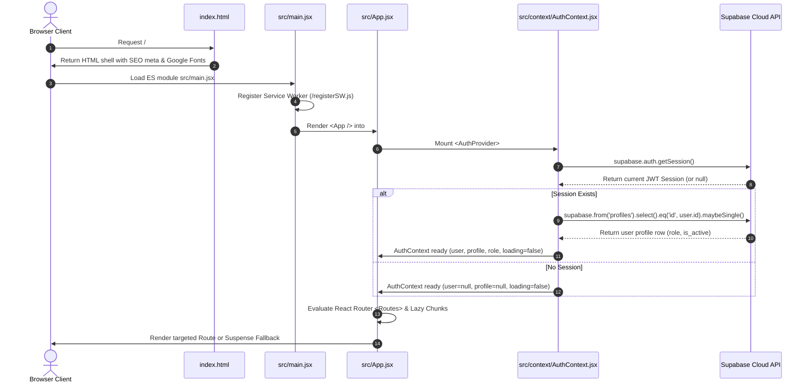

# Application Entry Points & Bootstrap Lifecycle

Audit Date: 2026-10-13  
Platform: Thoughtful's Academy

---

## 1. Application Lifecycle & Bootstrap Sequence

---

## 2. Key Entry Point Files

### 2.1 `index.html` (Host Shell)
- **Primary Function:** HTML5 application host containing critical Open Graph, Twitter Cards, PWA mobile tags, JSON-LD structured data (`EducationalOrganization`), and Google Fonts preconnect links (`Inter` & `Poppins`).
- **SEO Tokens:** Populated at build time via Vite environment replacement variables (`%VITE_INSTITUTE_NAME%`, `%VITE_SITE_URL%`, `%VITE_CONTACT_EMAIL%`).
- **Noscript Fallback:** Provides crawler-friendly fallback content for bots that do not execute JavaScript.

### 2.2 `src/main.jsx` (Client Root)
- **Primary Function:** Mounts the React component tree into DOM node `#root` using `ReactDOM.createRoot()`.
- **Router Context:** Wraps the root in `react-router-dom`'s `<BrowserRouter>`.
- **Global Styles:** Imports `src/index.css` to inject Tailwind directives and utility classes.

### 2.3 `src/App.jsx` (Routing Core)
- **Primary Function:** Orchestrates top-level application routing, code-splitting via `React.lazy()` and `<Suspense>`, global toast container (`<Toaster />`), and mobile PWA install trigger (`<InstallAppPrompt />`).
- **Route Guarding:** Wraps portal sub-trees in `<ProtectedRoute allowedRoles={['...']} />` to enforce role authorization.
- **Route Loader:** Displays animated `<RouteLoader />` while route chunks are fetched over the network.

### 2.4 `src/context/AuthContext.jsx` (Session Lifecycle)
- **Primary Function:** Subscribes to Supabase Auth session updates (`supabase.auth.onAuthStateChange`).
- **Profile Synchronization:** Fetches matching row from `profiles` table to determine user role and active status.
- **Deadlock Mitigation:** Dispatches `setTimeout(..., 0)` profile fetching inside the `onAuthStateChange` callback to avoid deadlocking `gotrue-js` internal async locks.

### 2.5 `netlify/functions/youtube-playlist.js` (Serverless Function Entry)
- **Primary Function:** Netlify serverless entry point mounted at `/.netlify/functions/youtube-playlist` and proxied via `/api/youtube-playlist`.
- **Proxy Behavior:** Accepts `listId` or `videoId`, resolves missing playlist IDs from YouTube watch pages, and fetches XML feeds from `https://www.youtube.com/feeds/videos.xml`.

### 2.6 `supabase/functions/send-push/index.ts` (Edge Function Entry)
- **Primary Function:** Supabase Edge Function triggered by PostgreSQL database webhooks upon new rows in `notifications` or `messages`.
- **Delivery Flow:** Resolves active recipients, looks up Web Push subscription endpoints in `push_subscriptions`, and transmits VAPID-signed payloads using `npm:web-push@3.6.7`.
