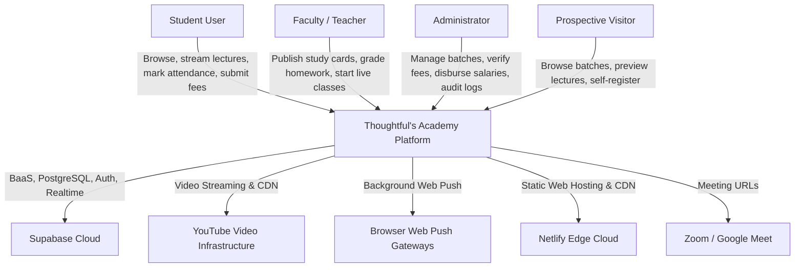
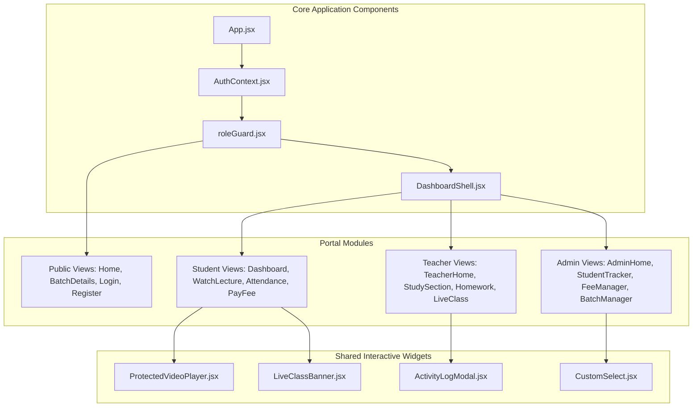
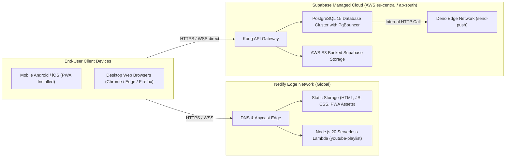
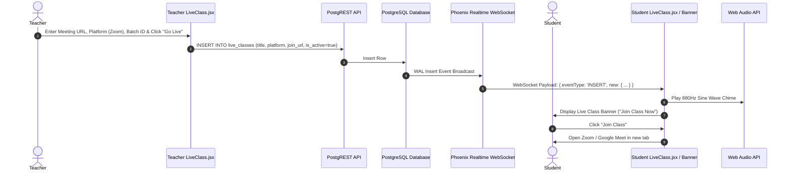
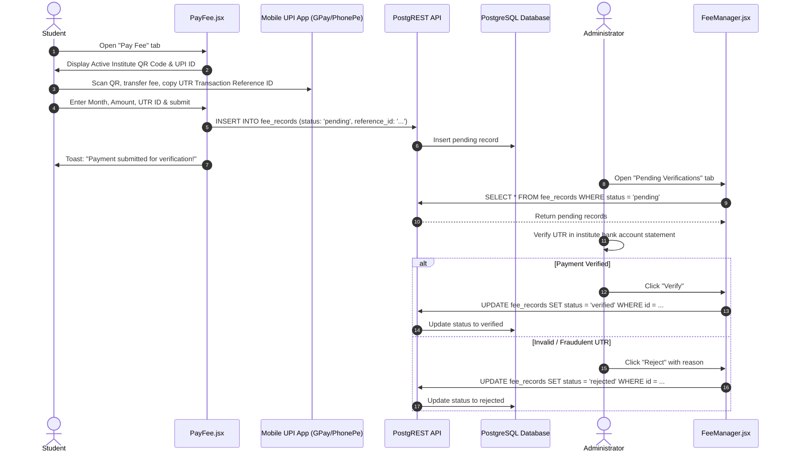

# Comprehensive Architecture Diagrams

Audit Date: 2026-10-13  
Platform: Thoughtful's Academy

---

## 1. System Context Diagram (C4 Level 1)



---

## 2. Container Diagram (C4 Level 2)

```mermaid
graph TD
    subgraph ClientContainer["Client Tier"]
        SPA["React 18 Single Page Application (Vite Bundled)"]
        SW["Service Worker (Workbox + push-sw.js)"]
    end

    subgraph NetlifyContainer["Hosting Tier"]
        CDN["Netlify Global CDN Edge"]
        NetlifyFn["Serverless Function: youtube-playlist.js"]
    end

    subgraph SupabaseContainer["BaaS Tier (Supabase Cloud)"]
        GoTrue["Supabase GoTrue (Auth)"]
        PostgREST["PostgREST (REST API)"]
        Realtime["Realtime (Phoenix WebSockets)"]
        Storage["Supabase Storage (Buckets: qr-codes, teacher-qr)"]
        EdgeWorker["Deno Edge Function (send-push)"]
        PostgresDB[("PostgreSQL 15 Database (18 Tables)")]
    end

    SPA -->|Fetch HTML, JS, CSS| CDN
    SPA -->|Resolve Playlists / XML Feeds| NetlifyFn
    SPA -->|Authentication & JWT Sessions| GoTrue
    SPA -->|Data Queries & Mutations (RLS)| PostgREST
    SPA -->|Subscribe to Live Changes| Realtime
    SPA -->|Upload QR Images| Storage
    SW -->|Offline Cache Interception| SPA

    PostgREST --> PostgresDB
    GoTrue --> PostgresDB
    Realtime --> PostgresDB
    Storage --> PostgresDB
    PostgresDB -->|Database Webhooks| EdgeWorker
```

---

## 3. Component Diagram (C4 Level 3)



---

## 4. Deployment Topology Diagram



---

## 5. Live Class Event Flow



---

## 6. Offline UPI Fee Reconciliation Flow


