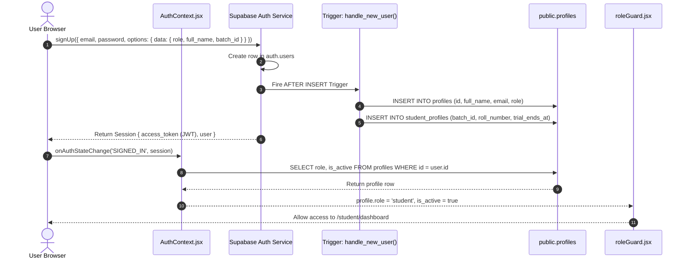

# Authentication & Authorization Architecture

Audit Date: 2026-10-13  
Platform: Thoughtful's Academy

---

## 1. Authentication Architecture

The platform uses **Supabase Auth (GoTrue)** as its identity provider:

---

## 2. Authentication Mechanism Details

1. **Token Lifecycle:**
   - Supabase Auth issues an asymmetric JWT access token signed by the project's JWT secret (HS256).
   - Access tokens have a default lifetime of 3,600 seconds (1 hour).
   - A long-lived refresh token is stored in the browser's `localStorage` under key `sb-<project-ref>-auth-token`.
   - The Supabase client automatically refreshes the token in the background (`autoRefreshToken: true`).
2. **Session Persistence:**
   - Handled via `persistSession: true` in `lib/supabase.js`.
   - On page refresh, `supabase.auth.getSession()` synchronously pulls the cached session from `localStorage`.
3. **Password Recovery Flow:**
   - Request initiated at `/login` via `supabase.auth.resetPasswordForEmail()`.
   - User receives email containing magic link with recovery token hash.
   - Redirected to `/reset-password` where `detectSessionInUrl: true` catches the token and fires the `PASSWORD_RECOVERY` event.
   - User updates password via `supabase.auth.updateUser({ password })`.

---

## 3. Role-Based Access Control (RBAC) Architecture

The application enforces authorization across two independent tiers:

### 3.1 Frontend Routing Layer (`src/utils/roleGuard.jsx`)
- `<ProtectedRoute allowedRoles={['student']} />` acts as a route guard.
- Blocks unauthenticated users and redirects to `/login`.
- Blocks deactivated accounts (`is_active = false`) and redirects to `/account-suspended`.
- Blocks role mismatches (e.g. student accessing `/admin/*`) and redirects to `/unauthorized`.
- *Security Caveat:* Frontend routing guards protect user experience but provide **no security guarantee** against direct API requests.

### 3.2 Database Row Level Security Layer (PostgreSQL RLS)
- PostgreSQL RLS is the true enforcement boundary.
- Helper Functions in PostgreSQL:
  * `get_my_role()`: `SELECT role FROM profiles WHERE id = auth.uid();`
  * `is_admin()`: `SELECT EXISTS (SELECT 1 FROM profiles WHERE id = auth.uid() AND role = 'admin');`
  * `teacher_can(perm)`: Verifies permissions in `teacher_profiles` or checks active batch assignment in `batches.teacher_id` / `batches.teacher_ids`.

---

## 4. Discovered Authorization Vulnerabilities

1. **[SEC-001](../SECURITY/SECURITY_FINDINGS.md#SEC-001) — Client Metadata Admin Injection:**
   * In `014_handle_new_user.sql`, line 9: `v_role := COALESCE(meta->>'role', 'student');`
   * An attacker can supply `options: { data: { role: 'admin' } }` to `signUp()` and gain full admin rights.
2. **[SEC-003](../SECURITY/SECURITY_FINDINGS.md#SEC-003) — Self-Elevation via Unconstrained Profile Update:**
   * Policy `"profiles: own update"` allows `auth.uid() = id` without restricting the columns that can be modified.
   * An authenticated student can call `supabase.from('profiles').update({ role: 'admin' }).eq('id', user.id)` to escalate to admin.
3. **[SEC-004](../SECURITY/SECURITY_FINDINGS.md#SEC-004) — Client-Bake Admin Invite Code:**
   * `VITE_ADMIN_CODE` is checked on the client side in `Register.jsx` line 124, exposing the invite code to anyone inspecting client bundles.
