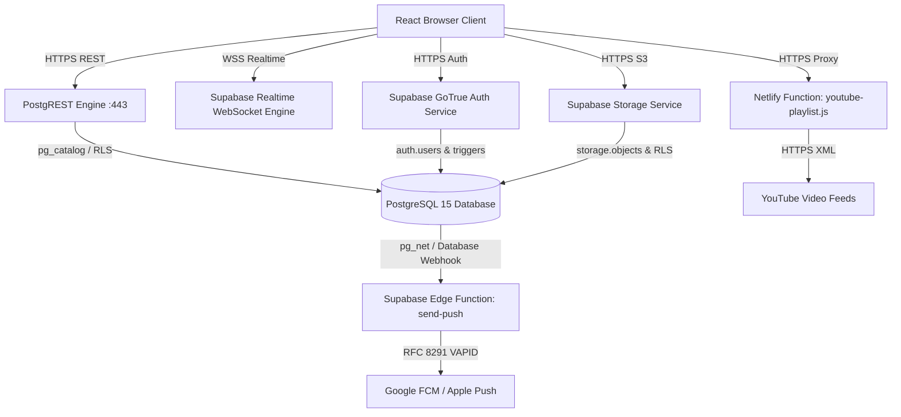

# Backend Architecture & Serverless Infrastructure

Audit Date: 2026-10-13  
Platform: Thoughtful's Academy

---

## 1. Backend Architecture Overview

The platform uses a **Serverless / BaaS Backend Model** anchored by Supabase Cloud services and complemented by Netlify and Deno Edge functions:

---

## 2. Backend Service Layers

### 2.1 PostgREST Layer (Automated REST API)
- PostgREST exposes all tables in the `public` schema as RESTful JSON endpoints (`/rest/v1/{table_name}`).
- Features supported out-of-the-box:
  * Filtering (`eq`, `neq`, `gt`, `gte`, `lt`, `lte`, `in`, `cs`, `is`)
  * Pagination (`limit`, `offset`, `order`)
  * Relationships and embedding (`select=*, profiles!teacher_id(full_name)`)
  * Exact count headers (`Prefer: count=exact`)

### 2.2 Security & Authorization Layer (PostgreSQL RLS)
- Because PostgREST provides direct table access, the entire authorization layer is implemented in SQL via **Row Level Security (RLS)**.
- Each incoming HTTP request contains an `Authorization: Bearer <JWT>` header parsed by PostgreSQL into `auth.uid()` and `auth.jwt()`.
- RLS policies restrict `SELECT`, `INSERT`, `UPDATE`, and `DELETE` queries to authenticated users holding legitimate permissions.

### 2.3 Netlify Serverless Function (`youtube-playlist.js`)
- **Route:** `GET /.netlify/functions/youtube-playlist` (rewritten via `netlify.toml` from `/api/youtube-playlist`).
- **Runtime:** Node.js 20 ESM.
- **Workflow:**
  1. Parses query parameter `listId` or `videoId`.
  2. If `videoId` is passed without `listId`, fetches `https://www.youtube.com/watch?v={videoId}` and extracts playlist ID matching regex `/"playlistId":"(PL[a-zA-Z0-9_-]+)"/`.
  3. Fetches `https://www.youtube.com/feeds/videos.xml?playlist_id={listId}`.
  4. Returns XML payload with `Cache-Control: public, max-age=900` and CORS headers.

### 2.4 Supabase Edge Function (`send-push/index.ts`)
- **Runtime:** Deno 1.x running at the Supabase Edge network.
- **Trigger:** Database Webhook (HTTP POST) on `notifications` and `messages` table inserts.
- **Security:** Validates `x-webhook-secret` header against `WEBHOOK_SECRET`.
- **Payload Generation:**
  * For notifications: Extracts type emoji, title, and body; resolves student batch memberships; and sends to push endpoints.
  * For messages: Resolves sender name and recipient ID; crafts push notification with direct link to `/{role}/messages`.
  * Deletes dead push subscriptions automatically upon HTTP 404/410 GCM responses.
