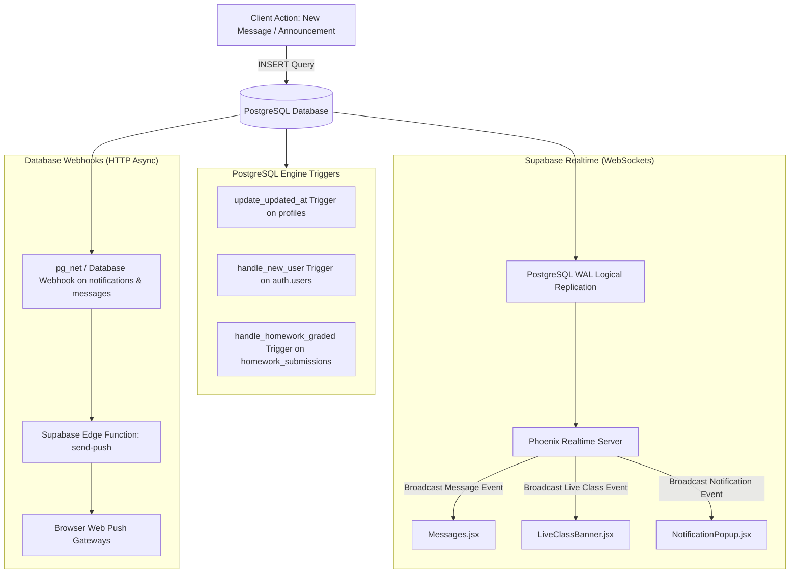

# Background Jobs, Events & Realtime Architecture

Audit Date: 2026-10-13  
Platform: Graviton Academy

---

## 1. Event Propagation Model

The platform does not operate a traditional background job queue (such as Celery, BullMQ, Sidekiq, or RabbitMQ). Instead, asynchronous events and background notifications are orchestrated through **PostgreSQL Triggers**, **Supabase Database Webhooks**, and **Phoenix WebSocket Channels**:

---

## 2. Event Handlers & Triggers

### 2.1 Database Triggers
1. **`update_updated_at()`:** Fires `BEFORE UPDATE ON profiles` to automatically maintain `updated_at = NOW()`.
2. **`handle_new_user()`:** Fires `AFTER INSERT ON auth.users` to provision `profiles` and role-specific rows (`student_profiles`, `teacher_profiles`).
3. **`handle_homework_graded()`:** Fires `AFTER UPDATE ON homework_submissions`. When `NEW.grade IS NOT NULL` and `OLD.grade IS NULL`, it automatically creates an announcement notification in `notifications` addressed to the student (`target_user_id = NEW.student_id`).

### 2.2 Supabase Realtime Channels
The application listens on the following active WebSocket channels:
- `live_class_{batchId}`: Listens for INSERT, UPDATE, DELETE on `live_classes`. Fires Web Audio chime and mounts `LiveClassBanner`.
- `messages_{userId}`: Listens for direct messages, appending to the active chat thread without page refreshes.
- `announcements_admin_list`: Updates admin notification listings dynamically when announcements are created or deleted.
- `student_homework_{userId}_{batchId}`: Keeps homework list and submission status synchronized in real time.

### 2.3 Web Push Background Delivery
- When a user is not actively on the site (browser tab closed), the Service Worker (`push-sw.js`) receives push events in the background via the browser OS push service.
- The service worker parses the payload (`title`, `body`, `tag`, `url`) and calls `self.registration.showNotification()`.
- Clicking the notification triggers `notificationclick`, bringing the PWA window to focus or opening the relevant module route.
