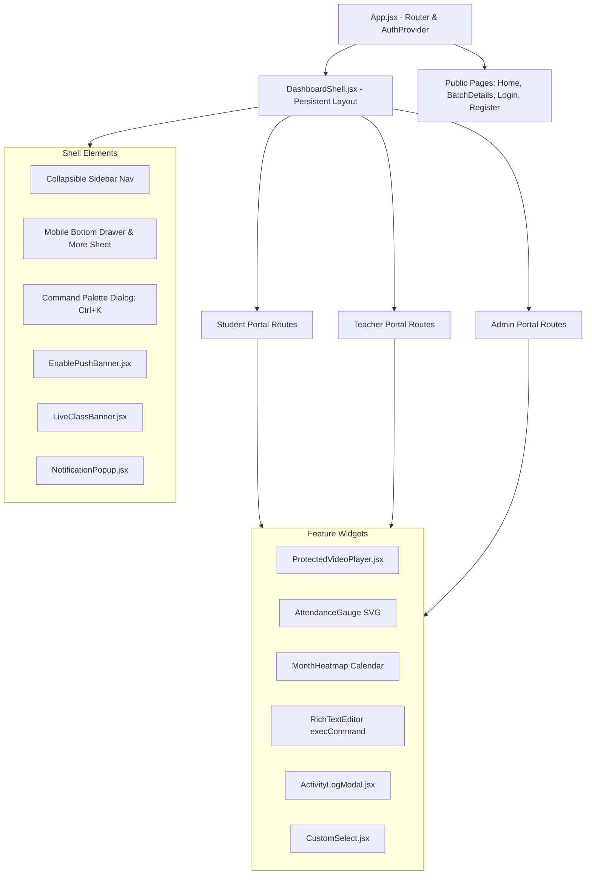

# Component Architecture & Design Patterns

Audit Date: 2026-10-13  
Platform: Graviton Academy

---

## 1. Component Hierarchy & Composition

The application adopts a **Layered Component Composition Model**:

---

## 2. Structural Component Categories

### 2.1 Layout Shell (`src/components/layout/DashboardShell.jsx`)
- **Responsive Adaptivity:** Renders a full desktop sidebar (collapsible from 260px to 80px) and a mobile bottom tab bar (Home, Attendance/Study, Live Class, Notifications, and "More" trigger).
- **Navigation Sheet:** "More" button reveals a touch-friendly bottom drawer organizing extra portal links with an automatic 6-second inactivity auto-dismiss timer.
- **Command Palette (`Ctrl+K` / `Cmd+K`):** Integrated modal search allowing users to instantly jump to any route across the portal using fuzzy keyboard navigation.
- **Badge Integration:** Reads unread counts from `useNavBadges` hook and renders amber/red notification indicators on sidebar items.

### 2.2 Domain Player (`src/components/shared/ProtectedVideoPlayer.jsx`)
- **1,607 LOC Mega-Component:** Houses the core student classroom video viewing interface.
- **Shielding Techniques:**
  * Embeds YouTube via `window.YT.Player` inside an iframe container with pointer-events protection.
  * Disables YouTube native controls, annotations, related videos, and branding links (`modestbranding=1`, `rel=0`, `controls=0`).
  * Implements custom overlay controls: Play/Pause, Seek forward/back (+10s/-10s), Scrubbing bar with hover previews, Resolution selection (480p, 720p, 1080p, Auto), Speed presets (0.5x to 2x), 2x press-and-hold accelerator, and Screen lock toggle.
  * Progress Persistence: Automatically debounces and syncs current playback timestamps to `localStorage` (`ta_lecture_progress_v1`).

### 2.3 Shared UI Primitives
- **`src/components/ui/CustomSelect.jsx`:** Custom replacement for native HTML select tags to avoid platform styling inconsistencies across iOS Safari and Android Chrome.
- **`src/components/shared/DriveImage.jsx`:** Dynamically parses Google Drive sharing links (`drive.google.com/file/d/...`) into direct Googleusercontent image thumbnail URLs (`https://lh3.googleusercontent.com/u/0/d/...`) with fallback image handlers.
- **`src/components/shared/ActivityLogModal.jsx`:** Pop-up audit log viewer rendering 24-hour batch creation, update, deletion, and visibility toggles recorded in `activity_logs`.
- **`src/components/shared/NotificationPopup.jsx`:** Realtime floating snackbar that slides in at the bottom-right when a new notification is broadcast via Supabase Realtime.

---

## 3. Component Coupling & Anti-Patterns

1. **Oversized Megalithic Components:**
   * `src/pages/teacher/StudySection.jsx` (1,949 LOC): Combines batch selection, workspace card layouts, card creation modal, card edit drawer, subject filtering, activity logging, and drive link validation in a single file.
   * `src/components/shared/ProtectedVideoPlayer.jsx` (1,607 LOC): Bundles player engine, gesture listeners, time formatters, keyboard shortcuts, resolution menus, and SVG overlays in a single file.
   * `src/pages/student/StudentDashboard.jsx` (1,392 LOC): Combines streak calculations, SVG gauges, homework previews, real-time live class polling, and cache management in a single file.
2. **Duplicated Component Variants:**
   * `TeacherStudySection.jsx` vs `StudentStudySection.jsx` share 70% of UI layout and card styling logic but maintain independent codebases rather than extracting a shared `<StudyCardGrid />` component.
   * `AdminMessages.jsx`, `TeacherMessages.jsx`, and `StudentMessages.jsx` duplicate message bubble rendering, timestamp separation, and chat input logic across 3 separate files.
