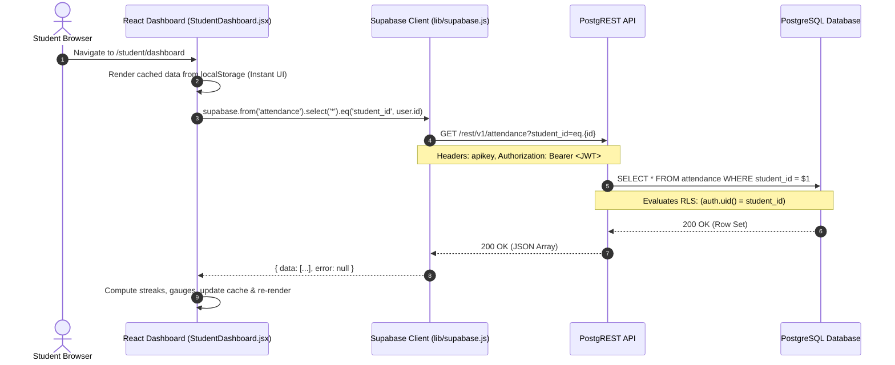
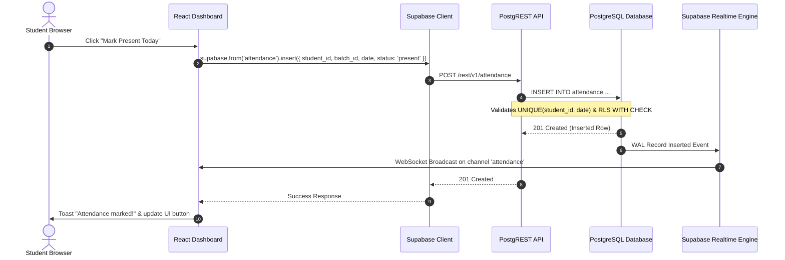
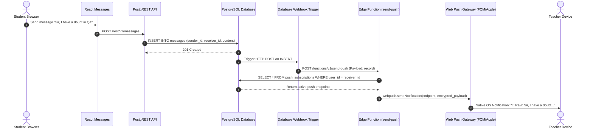

# Request & Response Lifecycle

Audit Date: 2026-10-13  
Platform: Thoughtful's Academy

---

## 1. End-to-End Request Lifecycles

### 1.1 Data Fetching Request (e.g. Student Loading Dashboard)

### 1.2 Data Mutation Request (e.g. Marking Attendance)

### 1.3 Message Send & Push Notification Flow

