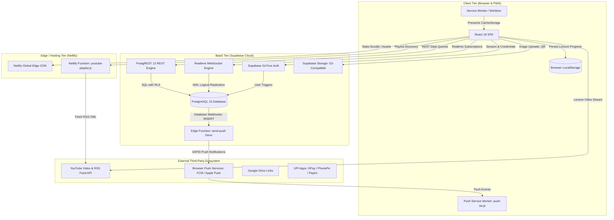

# System Overview & Architecture

Audit Date: 2026-10-13  
Platform: Thoughtful's Academy  
Architecture Paradigm: Client-Heavy Single Page Application (SPA) + Progressive Web App (PWA) with Backend-as-a-Service (BaaS) and Serverless Edge Extensions.

---

## 1. High-Level System Architecture

Thoughtful's Academy employs a **Client-Heavy 3-Tier Web Architecture** combining a static frontend distributed globally via Netlify CDN, a hosted Supabase PostgreSQL backend accessed via PostgREST and Phoenix WebSocket channels, and dedicated serverless functions for third-party orchestration.

---

## 2. Core Architectural Characteristics

### 2.1 Backend-as-a-Service (BaaS) Model
The application avoids a traditional dedicated monolithic backend server (such as Express.js, NestJS, Django, or Spring Boot). Instead:
- All database CRUD operations are performed directly from the browser using the `@supabase/supabase-js` SDK connecting to PostgREST.
- Business logic validation, relational constraints, foreign keys, and access permissions are delegated to **PostgreSQL Row Level Security (RLS)** policies.
- Real-time updates (attendance marking, live class broadcasts, direct chat, unread notifications) bypass polling through Supabase Realtime WebSocket subscriptions on PostgreSQL tables.

### 2.2 Progressive Web App (PWA) Delivery
- The application is configured as a fully installable PWA via `vite-plugin-pwa`.
- The service worker (`dist/sw.js`) precaches 62 assets (HTML, CSS, JS chunks, icons) totaling 1.82 MB.
- When offline or on unstable mobile networks, cached assets load immediately, followed by runtime network-first strategies for Supabase REST queries and cache-first for Google Fonts and YouTube thumbnails.

### 2.3 Serverless Compute Extensions
Two specialized serverless functions augment the BaaS layer:
1. **`netlify/functions/youtube-playlist.js`:** Solves CORS and API quota restrictions by scraping YouTube playlist IDs from watch URLs and fetching official YouTube RSS video feeds (`https://www.youtube.com/feeds/videos.xml?playlist_id=...`).
2. **`supabase/functions/send-push/index.ts`:** Deno-based Supabase Edge Function triggered by database webhooks on `messages` and `notifications` tables. It looks up recipient Web Push subscriptions and signs notifications with VAPID keys using `web-push`.

---

## 3. Modular Boundaries

| Boundary | Responsibilities | Key Technologies |
|---|---|---|
| **Public Gateway** | Home landing page, batch information, faculty profile, sample preview videos, student self-registration, user authentication. | `Home.jsx`, `BatchDetails.jsx`, `Login.jsx`, `Register.jsx` |
| **Student Domain** | Course discovery, lecture video player, doubt messaging, attendance heatmap & streaks, homework submission, fee payment receipt upload. | `StudentDashboard.jsx`, `WatchLecture.jsx`, `Attendance.jsx`, `PayFee.jsx` |
| **Teacher Domain** | Study card publishing, multi-batch assignment, homework assignment & grading, live class broadcasts, salary viewing. | `TeacherHome.jsx`, `StudySection.jsx`, `Homework.jsx`, `LiveClass.jsx` |
| **Admin Central** | Institute governance, student enrollment tracking, teacher permission toggling, batch management, manual UPI fee verification, payroll disbursement, database reset. | `AdminHome.jsx`, `StudentTracker.jsx`, `FeeManager.jsx`, `BatchManager.jsx`, `AdminSettings.jsx` |
| **Shared Shell** | Responsive sidebar navigation, role-based layout shell, mobile bottom drawer, command palette (`Ctrl+K`), audio chimes, push notification banner. | `DashboardShell.jsx`, `ProtectedVideoPlayer.jsx`, `NotificationPopup.jsx` |
