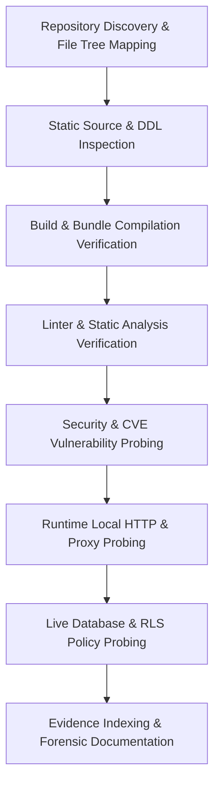

# Audit Methodology & Evidence Collection Protocol

Audit Date: October 13, 2026  
Execution Paradigm: Autonomous Forensic Engineering Audit  
Auditor: Principal Software Architect & QA Specialist

---

## 1. Audit Principles & Objectives

The platform audit was conducted following strict non-destructive, evidence-backed inspection protocols:
1. **Zero Destructive Operations:** Existing databases, tables, records, local processes, and configuration files were not reset, dropped, or corrupted.
2. **Read-Only Codebase Preservation:** Existing source files in `src/`, `supabase/`, `netlify/`, and configuration manifests were left intact.
3. **Multi-Layer Forensic Correlation:** Static code analysis was cross-referenced with live database queries, network probes, and bundler compilation outputs.
4. **Distinction of Fact from Inference:**
   - *Observed Fact:* Directly executed CLI output, curl response, or bundler result.
   - *Code-Derived Fact:* Directly identified from source syntax, database DDL, or component code.
   - *Reasonable Inference:* Deductions based on standard PostgREST and React runtime conventions.
   - *Assumption / Limitation:* Clearly stated boundary where live external infrastructure was inaccessible.

---

## 2. Forensic Investigation Procedures

### 2.1 Static Code & Configuration Analysis
- Full traversal of all 85+ repository files using AST-aware syntax inspection, dependency tree parsing, and line counting.
- Inspection of 24 PostgreSQL migrations in `supabase/migrations/` to trace schema evolution, triggers, RLS policies, and index coverage.
- Detailed inspection of authentication flows (`AuthContext.jsx`, `roleGuard.jsx`, `handle_new_user()`).

### 2.2 Compilation & Build Verification
- Invoked `npm run build` using the project's native Vite bundler.
- Measured compilation latency (10.19 seconds), Rollup chunk splitting, PWA precache generation, and asset sizes.
- Verified absence of TypeScript/JSX syntax errors and build blockers.

### 2.3 Code Quality & Linter Probing
- Executed `npm run lint` utilizing ESLint 9.13.0 with React and Hooks plugins.
- Verified clean syntax compliance across all 73 frontend components.

### 2.4 Dependency Vulnerability Auditing
- Executed `npm audit` against active dependency manifests (`package.json` and `package-lock.json`).
- Categorized 19 discovered vulnerabilities across Severity (Moderate, High) and affected packages (`brace-expansion`, `braces`, `postcss`, `react-router`, `fast-uri`, `esbuild`).

### 2.5 Runtime Network & HTTP Probing
- Probed active development server (`http://localhost:5173`) running as PID 5289.
- Verified HTTP 200 responses across key public routes (`/`, `/login`, `/register`, `/batch-details`, `/manifest.json`, `/push-sw.js`).
- Probed the Vite YouTube proxy dev middleware (`/api/youtube-playlist`) under valid, missing, and invalid parameter conditions to verify upstream error handling.

### 2.6 Live Database & Row Level Security (RLS) Probing
- Connected to the live Supabase project instance specified in `.env.local` using read-only PostgREST queries with the application anon key.
- Verified read access to public tables (`batches`, `study_cards`).
- Verified RLS blocking behavior on 11 sensitive tables (`profiles`, `messages`, `fee_records`, `salary_records`, `homework`, `attendance`, `activity_logs`, etc.), ensuring zero unauthenticated data leaks.
