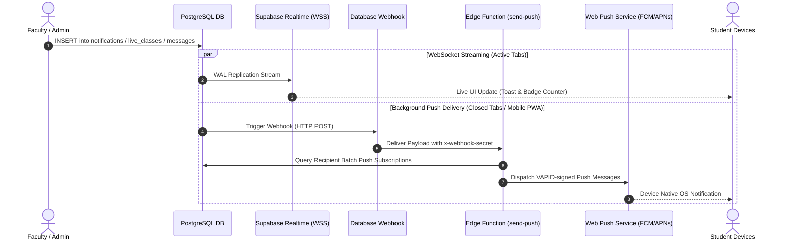

# Background Processing, Realtime Events & Push Pipeline

**Platform:** Graviton Academy (Coaching Institute Management System)  
**Architecture:** PostgreSQL Write-Ahead Log (WAL) Replication + Deno Edge Webhooks + Web Push RFC 8292  
**Realtime Technology:** Supabase Realtime (Phoenix Channels / WebSockets)  
**Push Relay Engine:** `web-push@3.6.7` on Deno Edge  

---

## 1. Asynchronous Architecture & Event Flow

The platform relies on an event-driven architecture to keep client user interfaces synchronized in real time and deliver notifications even when the application is closed:



---

## 2. Realtime WebSocket Subscriptions (`src/hooks/useRealtime.js`)

### 2.1 Subscribed Channels & Handlers
Active browser sessions establish persistent WebSocket connections through `@supabase/supabase-js`:
1. **Live Broadcast Beacon (`public:live_classes`):**
   - Listens for `INSERT` and `UPDATE` events.
   - When `status` changes to `"live"`, `LiveClassBanner.jsx` renders an animated banner and triggers an audible 880Hz synthesized chime.
2. **Institute Announcements (`public:notifications`):**
   - Updates the unread badge counter in `DashboardShell.jsx` without requiring page reloads.
3. **Chat Messenger (`public:messages`):**
   - Injects incoming student/teacher messages directly into the active chat stream.

---

## 3. Web Push Notification Engine (`send-push`)

### 3.1 Recipient Resolution Logic
The Edge Function (`supabase/functions/send-push/index.ts`) resolves targeted users dynamically:
- **Role Filtering:** Checks `target_role` (`"student"`, `"teacher"`, or `"all"`).
- **Batch Isolation:** If `target_batch_id` is defined, restricts delivery strictly to students enrolled in that specific batch via `student_profiles.batch_id`.
- **Active User Enforcement:** Queries `profiles.is_active = true` to prevent sending notifications to suspended accounts.
- **Author Exclusion:** Excludes `created_by` user ID so the instructor does not receive a push alert for their own announcement.

### 3.2 Visual Payload Formatting
Notification titles are automatically prepended with domain-specific emojis:
- Fee Alert: `💰 Fee Record Updated`
- Live Class: `🔴 Live Class Starting Now`
- Broadcast Notice: `📢 Institute Announcement`
- Homework Assignment: `📝 New Assignment Uploaded`
- 1-on-1 Chat: `💬 New Message from Instructor`

### 3.3 Dead Subscription Garbage Collection
If an end-user revokes browser notification permissions or uninstalls the PWA, push relays (FCM, Apple APNs) respond with HTTP `404 Not Found` or `410 Gone`. The Edge Function catches these status codes and automatically executes:
```typescript
await admin.from('push_subscriptions').delete().eq('endpoint', s.endpoint)
```
This guarantees the push database remains pruned of invalid endpoints.
