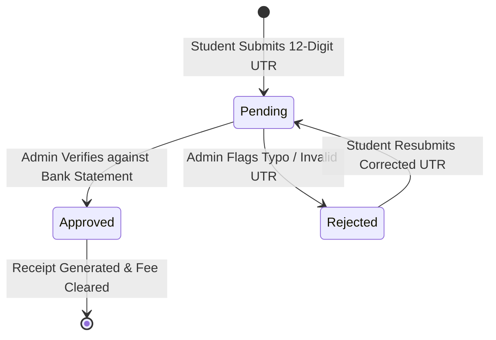

# Backend Business Logic & Domain Rule Specifications

**Platform:** Thoughtful's Academy (Coaching Institute Management System)  
**Domain Scope:** Academic Enrollment, Automated Roll Numbers, Fee Reconciliation, Payroll Disbursement, Curriculum Progression, and Granular Faculty Delegation  

---

## 1. Automated Roll Number Generation Logic

### 1.1 Algorithmic Specification
Implemented in PostgreSQL trigger function `public.handle_new_user()` (`supabase/migrations/014_handle_new_user.sql`):

```sql
v_year := TO_CHAR(CURRENT_DATE, 'YYYY');

-- Derive 3-letter uppercase prefix from batch title
SELECT UPPER(SUBSTRING(REPLACE(name, ' ', ''), 1, 3)) INTO v_batch_pref
FROM public.batches WHERE id = v_batch_id;

-- Calculate current sequence number
SELECT COUNT(*) + 1 INTO v_seq
FROM public.student_profiles WHERE batch_id = v_batch_id;

-- Construct formatted Roll Number: YYYY-PREFIX-001
v_roll_number := v_year || '-' || COALESCE(v_batch_pref, 'B') || '-' || LPAD(v_seq::text, 3, '0');
```

### 1.2 Evaluation & Concurrency Risk
- **Format:** `2026-JEE-001`, `2026-NEET-014`, `2026-CLA-005`.
- **Concurrency Defect (`DATA-002`):** `COUNT(*) + 1` is not wrapped in a row lock (`FOR UPDATE`) or backed by a PostgreSQL `SEQUENCE`. If two students register concurrently for the same batch, both transactions read identical count values, producing a duplicate roll number collision that violates unique constraints.

---

## 2. Fee Reconciliation State Machine

### 2.1 State Transition Lifecycle


### 2.2 Domain Invariants
- A student cannot have multiple `pending` fee records for the identical batch and month.
- An `approved` fee record is immutable; students cannot edit the UTR number once verified.
- Rejection requires an explicit administrative explanation string saved to `rejection_reason`.

---

## 3. Faculty Payroll & Disbursement Logic

### 3.1 Compensation Model
- Faculty base compensation is defined in `teacher_profiles.salary_amount`.
- Admin generates monthly salary slips in `public.salary_records`:
  $$	ext{Net Payout} = 	ext{Base Salary} + 	ext{Bonuses} - 	ext{Deductions}$$
- Payout status moves from `pending` to `paid` upon entering transaction reference and payment date.
- Teachers possess read-only visibility into their own salary records via RLS policy:
  `USING (auth.uid() = teacher_id)`.

---

## 4. Attendance & Streak Computation

### 4.1 Daily Attendance
- Attendance is recorded daily per student (`status IN ('present', 'absent', 'late')`).
- Only assigned teachers or administrators can mark or edit student attendance records.

### 4.2 Streak Engine
- The client-side dashboard queries consecutive days where `status = 'present'` ordered by `date DESC`.
- Days where no batch classes were scheduled (weekends or institutional holidays) do not reset the streak counter.

---

## 5. Granular Faculty Permission Rules

The platform implements delegation flags in `teacher_profiles`:
```sql
can_manage_study_cards   BOOLEAN DEFAULT false,
can_manage_homework      BOOLEAN DEFAULT false,
can_drop_live_class      BOOLEAN DEFAULT false,
can_message_students     BOOLEAN DEFAULT true,
can_view_attendance      BOOLEAN DEFAULT false,
can_view_fee_records     BOOLEAN DEFAULT false
```

- When `can_manage_study_cards` is `true`, RLS policies allow the teacher to insert and update rows in `study_cards` and `chapters` for batches they are assigned to.
- When `can_drop_live_class` is `true`, the teacher can initialize rows in `live_classes` and broadcast streaming URLs.
