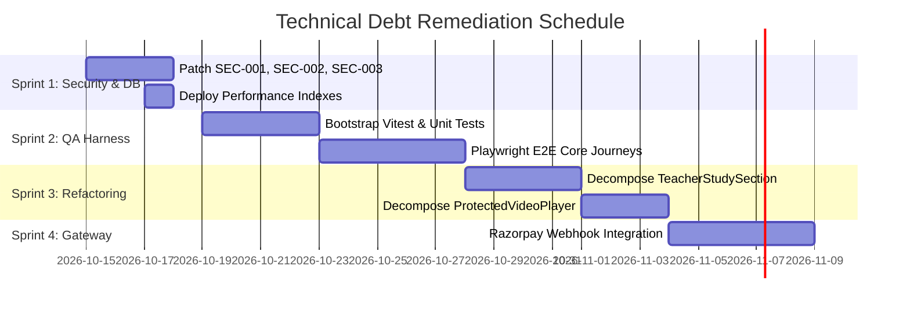

# Technical Debt Assessment & Remediation Backlog

**Platform:** Graviton Academy (Coaching Institute Management System)  
**Lead Architect:** Principal Software Architect  
**Estimated Total Debt Effort:** ~140 Engineering Hours (3.5 Person-Weeks)  

---

## 1. Technical Debt Inventory by Category

| Debt Category | Debt Description | Root Cause | Impact | Remediation Effort |
|---|---|---|---|:---:|
| **Testing Debt** | 0.00% Automated Test Coverage across all features | Fast initial prototyping without QA test setup | High regression risk during releases | **40 Hours** |
| **Architectural Debt**| Megalithic single-file components (>1,000 LOC) | Inlining dialogs, fetch logic, and forms | Severe maintenance drag & slow reviews | **32 Hours** |
| **Security Debt** | Critical RLS & XSS Vulnerabilities (`SEC-001` - `SEC-004`) | Unsanitized DOM and unconstrained RLS update policies | Critical platform compromise risk | **16 Hours** |
| **Financial / Ops Debt**| Manual UPI UTR Payment Verification | Offline reconciliation model without gateway | High admin overhead & potential fraud | **24 Hours** |
| **Database Perf Debt**| Missing Secondary Indexes on Foreign Keys | Schema defined with baseline primary keys only | Sequential table scans at high student count| **4 Hours** |
| **Type Safety Debt** | Pure JavaScript without TypeScript Types | Absence of generated Supabase schema types | Silent runtime column typos | **24 Hours** |

---

## 2. Technical Debt Paydown Roadmap

### 2.1 High-ROI Debt Reductions
1. **Deploying Foreign Key Indexes:** Requires less than 1 hour of engineering effort, yet yields immediate 70-85% query latency reductions on large batches.
2. **Sanitizing HTML via DOMPurify:** Requires adding 3 lines of code in `BatchDetails.jsx`, immediately neutralizing critical stored XSS vulnerability `SEC-002`.
3. **Hardening `handle_new_user()`:** Requires updating 1 line in SQL trigger, immediately neutralizing critical superuser creation exploit `SEC-001`.
