# Entity Relationship (ER) Diagram

**Platform:** Thoughtful's Academy (Coaching Institute Management System)  
**Database Engine:** PostgreSQL 15.6  
**Format:** Mermaid ER Syntax  
**Entities Rendered:** 18 Core Relational Tables + Supabase `auth.users`  

---

## 1. Visual Entity Relationship Architecture

```mermaid
erDiagram
    AUTH_USERS ||--|| PROFILES : "1:1 id"
    PROFILES ||--o| STUDENT_PROFILES : "1:1 id"
    PROFILES ||--o| TEACHER_PROFILES : "1:1 id"
    
    BATCHES ||--o{ STUDENT_PROFILES : "enrolls (batch_id)"
    BATCHES ||--o{ STUDY_CARDS : "contains (batch_id)"
    BATCHES ||--o{ ATTENDANCE : "tracks (batch_id)"
    BATCHES ||--o{ FEE_RECORDS : "bills (batch_id)"
    BATCHES ||--o{ LIVE_CLASSES : "streams (batch_id)"
    BATCHES ||--o{ NOTIFICATIONS : "targets (target_batch_id)"
    BATCHES ||--o{ HOMEWORK : "assigns (batch_id)"
    BATCHES ||--o{ ACTIVITY_LOGS : "logs (batch_id)"
    
    PROFILES ||--o{ ATTENDANCE : "student_id"
    PROFILES ||--o{ FEE_RECORDS : "student_id"
    PROFILES ||--o{ SALARY_RECORDS : "teacher_id"
    PROFILES ||--o{ LIVE_CLASSES : "hosted_by (teacher_id)"
    PROFILES ||--o{ NOTIFICATIONS : "created_by"
    PROFILES ||--o{ NOTIFICATION_READS : "user_id"
    PROFILES ||--o{ MESSAGES : "sender_id / receiver_id"
    PROFILES ||--o{ PUSH_SUBSCRIPTIONS : "user_id"
    PROFILES ||--o{ ACTIVITY_LOGS : "user_id"
    PROFILES ||--o{ HOMEWORK_SUBMISSIONS : "student_id"
    PROFILES ||--o{ STUDENT_BOOKMARKS : "student_id"
    
    STUDY_CARDS ||--o{ STUDENT_BOOKMARKS : "card_id"
    NOTIFICATIONS ||--o{ NOTIFICATION_READS : "notification_id"
    HOMEWORK ||--o{ HOMEWORK_SUBMISSIONS : "homework_id"

    PROFILES {
        uuid id PK
        string full_name
        string email
        string phone
        string role
        boolean is_active
        timestamp created_at
    }

    STUDENT_PROFILES {
        uuid id PK,FK
        uuid batch_id FK
        string roll_number
        string parent_phone
        date date_of_birth
        string_array subjects
        boolean is_trial
    }

    TEACHER_PROFILES {
        uuid id PK,FK
        string subject
        numeric salary_amount
        boolean can_manage_study_cards
        boolean can_manage_homework
        boolean can_drop_live_class
        boolean can_message_students
        boolean can_view_attendance
        boolean can_view_fee_records
    }

    BATCHES {
        uuid id PK
        string name
        string subject
        uuid teacher_id FK
        uuid_array teacher_ids
        numeric monthly_fee
        boolean is_active
    }

    STUDY_CARDS {
        uuid id PK
        uuid batch_id FK
        uuid chapter_id
        string title
        string youtube_url
        int duration
        string notes_url
        boolean is_published
    }

    ATTENDANCE {
        uuid id PK
        uuid student_id FK
        uuid batch_id FK
        date date
        string status
        timestamp marked_at
    }

    FEE_RECORDS {
        uuid id PK
        uuid student_id FK
        uuid batch_id FK
        numeric amount
        string month
        string payment_mode
        string utr_number
        string status
        timestamp verified_at
    }

    SALARY_RECORDS {
        uuid id PK
        uuid teacher_id FK
        numeric amount
        string month
        string status
        date payment_date
        string transaction_ref
    }

    MESSAGES {
        uuid id PK
        uuid sender_id FK
        uuid receiver_id FK
        string content
        boolean is_read
        timestamp created_at
    }

    NOTIFICATIONS {
        uuid id PK
        string title
        string body
        string type
        string target_role
        uuid target_batch_id FK
        boolean is_active
    }

    HOMEWORK {
        uuid id PK
        uuid batch_id FK
        uuid teacher_id FK
        string title
        string description
        date due_date
        string attachment_url
    }

    HOMEWORK_SUBMISSIONS {
        uuid id PK
        uuid homework_id FK
        uuid student_id FK
        string submission_url
        string grade
        string feedback
    }

    PUSH_SUBSCRIPTIONS {
        uuid id PK
        uuid user_id FK
        string endpoint
        string p256dh
        string auth
        timestamp created_at
    }

    ACTIVITY_LOGS {
        uuid id PK
        uuid batch_id FK
        uuid user_id FK
        string action_type
        string entity_type
        string entity_title
        timestamp created_at
    }

    QR_SETTINGS {
        uuid id PK
        string qr_image_url
        string upi_id
        string account_name
    }
```

