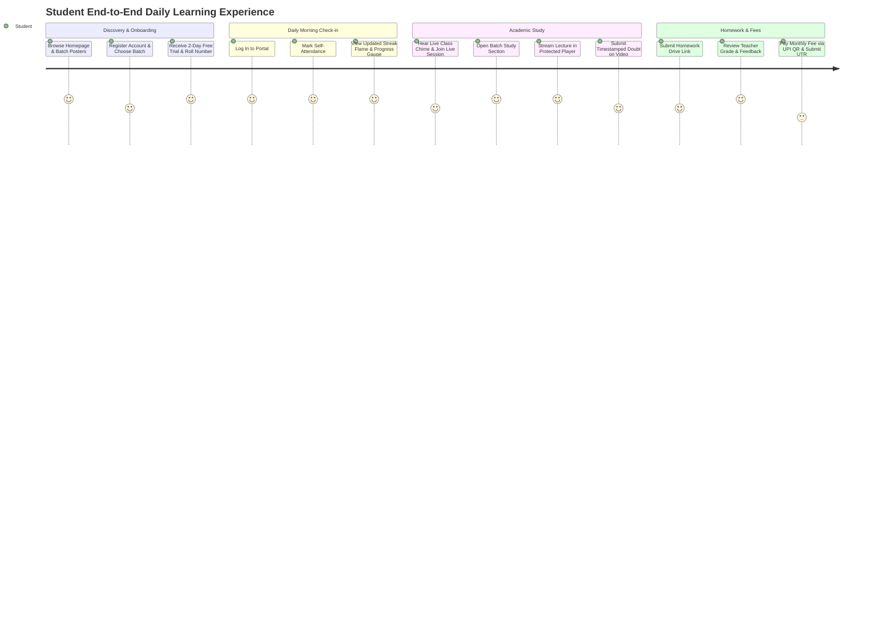
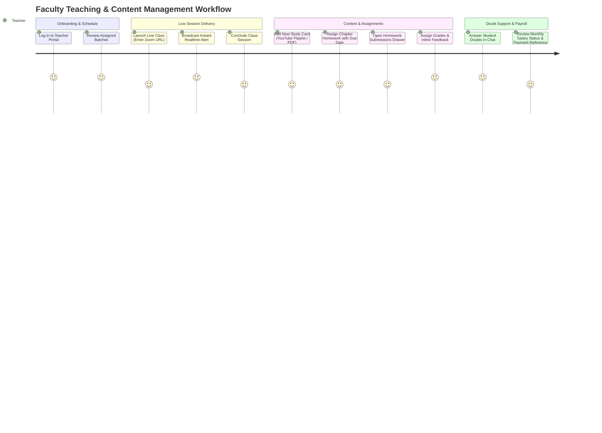
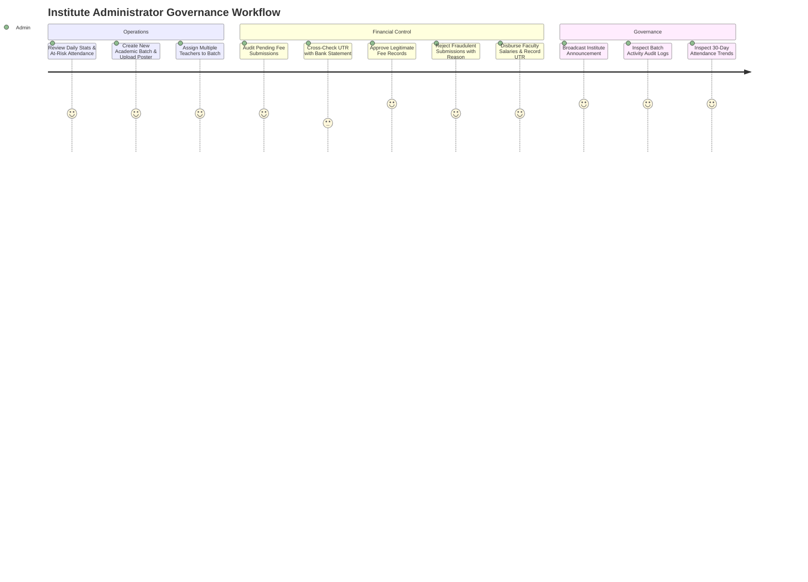

# End-to-End User Journeys

Audit Date: 2026-10-13  
Platform: Thoughtful's Academy

---

## 1. Student User Journey

### Detailed Steps:
1. **Onboarding:** Student visits `/`, navigates running batches, views batch syllabus on `/batch-details`, clicks "Register", inputs personal details, and selects batch subjects. The database creates a `student_profiles` row with a generated roll number (`2026-JEE-001`) and sets `trial_ends_at` to 48 hours in the future.
2. **Daily Routine:** Student logs in, checks in attendance via one click on `/student/dashboard`. If the student attended yesterday, the streak counter increments by 1.
3. **Classroom & Video:** Student opens `/student/study`, selects a subject chapter, and enters `/student/watch/:cardId`. The video plays with custom speed (1.5x) and clean mode enabled. If a doubt arises at 14:32, the student types a question in the "Ask Doubt" tab; this creates a message with timestamp `[14:32]` sent directly to the assigned teacher.
4. **Homework Submission:** Student opens `/student/homework`, finds the active assignment, pastes their Google Drive link, and submits. Once graded by faculty, an in-app announcement notification pops up alerting them to review feedback.
5. **Fee Payment:** Student navigates to `/student/pay-fee`, scans the institute's UPI QR code using PhonePe, transfers ₹2,500, inputs the 12-digit UTR reference ID, and submits for verification.

---

## 2. Faculty / Teacher User Journey

---

## 3. Administrator Governance Journey

