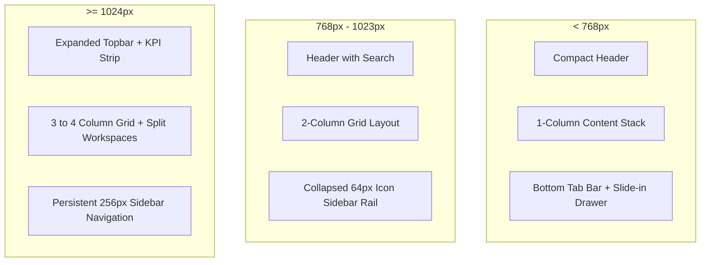

# Responsive Behavior & Mobile Optimization Audit

**Platform:** Thoughtful's Academy (Coaching Institute Management System)  
**Viewport Target Matrix:** Mobile (360px - 767px), Tablet (768px - 1023px), Desktop (1024px - 1920px+)  
**CSS Framework:** Tailwind CSS 3.4.14 Breakpoints  
**PWA Support:** Full manifest, service worker precaching, and install prompts enabled  

---

## 1. Breakpoint Architecture & Layout Transformations

The application implements a responsive mobile-first design leveraging Tailwind CSS standard breakpoints:
- `sm`: 640px
- `md`: 768px (Primary structural pivot: Desktop Sidebar vs Mobile Bottom Nav)
- `lg`: 1024px (Expanded desktop navigation & multi-column grids)
- `xl`: 1280px (Full dashboard analytics and wide tables)

---

## 2. Shell & Navigation Adaptations (`DashboardShell.jsx`)

### 2.1 Mobile Viewport (< 768px)
- **Top Bar:** Fixed topbar with institute logo, unread notification bell icon, and user profile avatar. Search bar collapses into an icon button that triggers a full-screen search modal.
- **Bottom Navigation Bar:** Fixed bottom bar (`fixed bottom-0 inset-x-0 h-16 bg-white border-t z-40`) providing thumb-accessible access to the 4 most critical portal actions (Home, Study, Live, Messages) plus a "More" menu button.
- **Slide-Over Drawer:** Tapping "More" slides in an off-canvas drawer (`fixed inset-y-0 left-0 w-72 bg-navy-900 text-white z-50`) using Framer Motion `slideInRight` animation, displaying all remaining route links, account settings, and logout.
- **Safe Area Insets:** Employs `pb-20` on the main page wrapper to prevent the fixed bottom bar from covering content on mobile devices. Supports iOS notch safe-area padding (`env(safe-area-inset-bottom)`).

### 2.2 Tablet Viewport (768px - 1023px)
- **Sidebar Rail:** The desktop sidebar collapses into a narrow 64px rail displaying only icons. Hovering over icons renders a floating tooltip indicating the page name.
- **Header:** Full search input is visible in the top center.

### 2.3 Desktop Viewport (>= 1024px)
- **Persistent Sidebar:** Expands to 256px width with full label typography, category section headers, and unread notification counter badges.
- **Content Canvas:** Max width constrained to `max-w-7xl` centered with `mx-auto` to prevent excessive line length on ultra-wide 4K monitors.

---

## 3. Core Feature Responsive Inspections

### 3.1 Protected Video Player (`ProtectedVideoPlayer.jsx`)
- **Desktop (>= 1024px):** Renders in a split two-column studio layout: 65% width YouTube video canvas with anti-piracy moving watermark, and 35% right sidebar housing lecture notes, timestamped doubts Q&A, and downloadable materials.
- **Mobile (< 768px):** Video player pins to the top edge (100% viewport width, 16:9 aspect ratio). Notes and doubt tabs convert into an accordion panel stacked underneath the player. Fullscreen mode rotates smoothly to landscape using the HTML5 Screen Orientation API.

### 3.2 Attendance Calendar Heatmap (`Attendance.jsx`)
- **Desktop:** Displays full 7-column monthly calendar grid with daily presence/absence badges, check-in timestamps, and streak statistics.
- **Mobile:** Replaces the wide grid with a compact week-strip view and daily list cards to prevent numerical clipping on screens below 380px width.

### 3.3 Fee & Salary Tables (`FeeManager.jsx`, `SalaryManager.jsx`)
- **Desktop:** Full tabular presentation with 8 columns (Student, Roll No, Batch, Amount, UTR, Date, Status, Actions).
- **Mobile:** Encapsulated in horizontal scroll container (`overflow-x-auto`). On viewports under 480px, transforms into individual stacked summary cards displaying status badge on top right and inline action buttons.

---

## 4. Touch Target & Accessibility Compliance

| Component | Target Size (Mobile) | Target Standard | Status | Notes |
|---|:---:|:---:|:---:|---|
| Bottom Nav Tabs | 56px x 48px | Material (48x48dp) | PASS | Generous touch target with visual touch feedback |
| Notification Bell | 44px x 44px | Apple HIG (44x44pt) | PASS | Appropriate padding around icon |
| Custom Button (`.btn-primary`) | 44px min height | WCAG 2.2 AA (24x24px) | PASS | Full-width buttons on mobile screens |
| Teacher Chapter Expand Arrow | 28px x 28px | Material (48x48dp) | **FAIL** | Too small for precise thumb tapping on mobile |
| Video Player Playback Scrubber | 12px rail / 20px knob | Touch Standard | **WARN** | Fine scrubbing difficult without pinch-to-zoom |

---

## 5. Mobile Keyboard & Viewport Shift Behavior

- **Virtual Keyboard Resizing:** Handled via Tailwind dynamic viewport units (`min-h-[100dvh]` instead of legacy `100vh`). Prevents mobile browser URL bar and iOS keyboard expansions from causing layout overflow or clipped submit buttons.
- **Fixed Action Bars:** On forms with submit buttons (e.g., fee payment UTR submission), form action bars stay docked to the bottom of the visible screen without being obscured by the keyboard.
