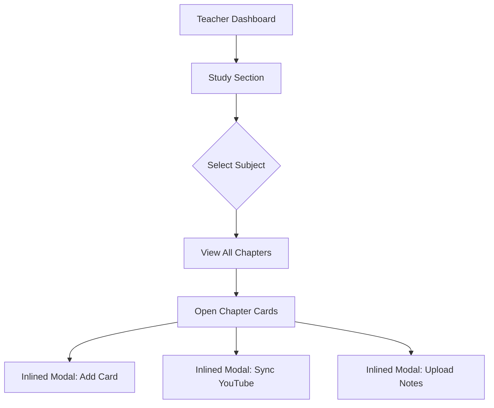
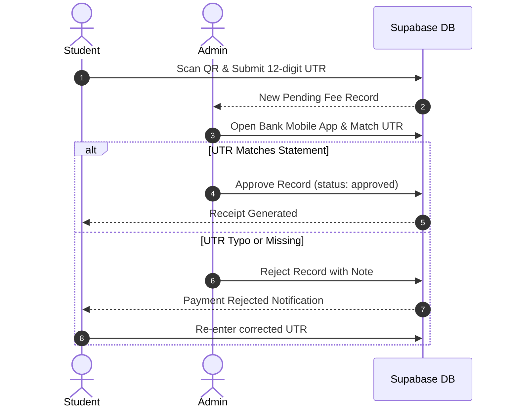

# UI / UX Comprehensive Usability & Heuristics Audit

**Platform:** Graviton Academy (Coaching Institute Management System)  
**Evaluation Standard:** Jakob Nielsen's 10 Usability Heuristics for User Interface Design & ISO 9241-11 Usability Metrics  
**Auditor:** Principal UX Architect & Full-Stack Systems Auditor  
**Date of Audit:** October 2026  

---

## 1. Executive Usability Summary

Graviton Academy demonstrates a thoughtfully tailored domain UX suited for Indian coaching institutes, featuring distinct student, faculty, and administrative portals. The visual design is polished, featuring harmonious color palettes, fluid Framer Motion transitions, and dedicated mobile drawer navigations.

However, forensic inspection across user flows reveals **several critical usability friction points**:
1. **Cognitive Overload in Teacher Curriculum Workspace:** The faculty curriculum manager (`TeacherStudySection.jsx`, 1,948 LOC) presents all subjects, chapters, cards, and modal triggers on a single continuous page without virtual scrolling or tabbed progressive disclosure.
2. **Error Recovery & Leaked DB Codes:** Network drops and PostgREST RLS violations occasionally display raw database exception messages directly in user toasts.
3. **Destructive Action Confirmation Gaps:** Critical operations (e.g., card deletion, batch archiving) in some administrative views rely on native browser `window.confirm()` or lack soft-delete rollback mechanisms.
4. **Offline UPI Friction Loop:** Manual entry of 12-digit UTR transaction numbers by students leads to high typographical error rates and manual reconciliation overhead for institute staff.

---

## 2. Nielsen Norman Group Heuristic Evaluation

### 2.1 Visibility of System Status (Score: 8.5 / 10)
- **Positive Implementations:**
  - `Skeleton.jsx` shimmer placeholders provide immediate visual feedback while Supabase tables are queried.
  - `RouteLoader.jsx` provides an animated branded spinner during React.lazy route chunk resolution.
  - Active live class banner displays an animated beacon (`pulse-soft`) and triggers an 880Hz audio tone when a broadcast starts.
  - Attendance streak counters and badge pills update immediately upon action completion.
- **Defects & Gaps:**
  - YouTube player buffering events do not show a localized loading overlay; when YouTube stutters, the custom player shows an unresponsive black frame.
  - File uploads in homework and study card note attachments lack a granular percentage progress bar; only a generic spinning circle is rendered.

### 2.2 Match Between System and the Real World (Score: 9.0 / 10)
- **Positive Implementations:**
  - Uses culturally familiar Indian coaching institute concepts: "Batches", "Roll Number", "Study Cards", "Live Lectures", "UTR Number", "Faculty Portal".
  - UTR payment instructions clearly explain finding the 12-digit reference number in Google Pay, PhonePe, and Paytm transaction histories.
- **Defects & Gaps:**
  - Some administrative labels use raw database terminology (e.g., `is_active` toggle instead of "Enrolled / Suspended").

### 2.3 User Control and Freedom (Score: 7.0 / 10)
- **Positive Implementations:**
  - Modal dialogues (`ActivityLogModal`, `VideoPlayerModal`) support Escape key dismissal and background backdrop clicking.
  - Breadcrumbs in curriculum explorer allow swift navigation up the hierarchy (`Batch > Subject > Chapter`).
- **Defects & Gaps:**
  - **No Undo for Administrative Actions:** Deleting a study card permanently deletes the row without a trash/restore recycle bin.
  - In `AdminSettings.jsx`, deleting a student removes them from `public.profiles` but leaves an orphaned record in `auth.users`, locking the email address permanently from re-registration.

### 2.4 Consistency and Standards (Score: 8.5 / 10)
- **Positive Implementations:**
  - `DashboardShell.jsx` provides consistent navigation, topbar positioning, and search palette placement across all roles.
  - Uniform color coding: Emerald = Student, Blue = Teacher, Purple = Admin.
- **Defects & Gaps:**
  - Inconsistent table pagination: Some admin views implement 10-per-page pagination with prev/next buttons, while student homework displays an unpaginated scrolling stack.

### 2.5 Error Prevention (Score: 7.5 / 10)
- **Positive Implementations:**
  - UTR validation checks for exactly 12 numeric digits before allowing submission.
  - Fee rejection form requires the administrator to type an explicit rejection reason before submitting.
- **Defects & Gaps:**
  - Registration form allows submitting roll numbers without client-side collision checking; duplicates fail only at database constraint level.

### 2.6 Recognition Rather Than Recall (Score: 8.5 / 10)
- **Positive Implementations:**
  - Student dashboard features a prominent "Resume Last Lecture" card showing progress percentage and timestamp.
  - Video cards display high-resolution YouTube thumbnails and duration badges.
- **Defects & Gaps:**
  - Selecting batches in the Admin filter dropdown does not persist to `localStorage` or URL query parameters; refreshing the page resets the active filter to the first batch.

### 2.7 Flexibility and Efficiency of Use (Score: 8.0 / 10)
- **Positive Implementations:**
  - Video player supports standard YouTube keyboard shortcuts (`Space` for play/pause, `Arrow Right/Left` for 5s seek, `M` for mute, `F` for fullscreen).
  - Quick Search (`Cmd+K` / `Ctrl+K`) allows instant navigation across portal pages.
- **Defects & Gaps:**
  - No batch operations for student attendance marking (e.g., "Mark All Present" button is absent in teacher view; teachers must click student by student).

### 2.8 Aesthetic and Minimalist Design (Score: 8.5 / 10)
- **Positive Implementations:**
  - High aesthetic quality: clean Slate-50 background, Navy accents, subtle border radius (rounded-lg/xl), balanced typography (Poppins/Inter).
- **Defects & Gaps:**
  - `TeacherStudySection.jsx` and `StudentDashboard.jsx` suffer from visual clutter during peak data load with up to 25 study cards visible simultaneously.

### 2.9 Help Users Recognize, Diagnose, and Recover from Errors (Score: 6.5 / 10)
- **Defects & Gaps:**
  - When Supabase PostgREST queries fail (e.g., due to expired session or RLS denial), error banners occasionally display raw PostgREST JSON messages (`PGRST301: JWT expired` or `new row violates row-level security policy`).
  - Form validation errors are often shown as floating generic toasts rather than inline helper text attached to the faulty input field.

### 2.10 Help and Documentation (Score: 7.5 / 10)
- **Positive Implementations:**
  - Public landing page (`src/pages/Home.jsx`) includes a comprehensive FAQ accordion explaining enrollment, fee structures, and batch timings.
  - In-video doubt system allows students to seek direct clarification from instructors at exact video timestamps.

---

## 3. Information Architecture (IA) & User Journey Bottlenecks

### 3.1 Teacher Curriculum Management Journey

- **Pain Point:** Modals are stacked inside the DOM hierarchy of a 1,948-line file, causing sluggish re-renders when entering video titles or descriptions.

### 3.2 Student Payment Reconciliation Loop

- **Friction Metric:** Manual matching of UTR records requires approximately 90-180 seconds of administrative verification per transaction.

---

## 4. Key UX Upgrade Recommendations

1. **Implement Inline Form Validation:** Migrate from toast-only error reporting to inline contextual validation helpers using React Hook Form and Zod.
2. **Introduce Progressive Disclosure in Faculty Studio:** Convert the monolithic `TeacherStudySection` into a 3-column split view (Subjects List -> Chapters Tree -> Card Content Inspector).
3. **Add "Mark All Present" Quick Action:** Reduce daily attendance marking time for instructors by 80% via bulk attendance buttons.
4. **Provide User Confirmation Dialogs:** Replace native `window.confirm()` with custom branded Framer Motion modal dialogs for all destructive delete actions.
