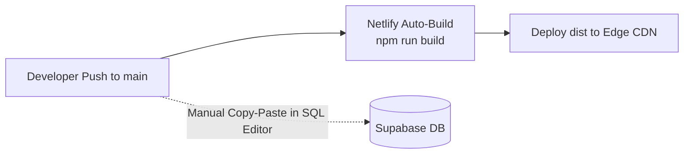

# Continuous Integration & Continuous Deployment (CI/CD) Pipeline

**Platform:** Graviton Academy (Coaching Institute Management System)  
**Lead DevOps Architect:** Principal Release Engineer  
**Current Automation:** Netlify Webhook Deploy on Git Push to `main`  

---

## 1. Current Deployment Pipeline vs Target Production Architecture

### 1.1 Existing Workflow

- **Observations & Gaps:**
  - Automated deployment triggers reliably for the frontend SPA upon git push.
  - **Severe Gap:** Database migrations are applied **manually** by developers copying and pasting SQL into the Supabase Dashboard SQL editor. This introduces high risk of human error, out-of-order migration execution, and schema drift.

---

## 2. Target Production CI/CD Pipeline (GitHub Actions Blueprint)

```mermaid
graph TD
    A[Pull Request / Git Push] --> B[Job 1: Static Code Lint (ESLint)]
    A --> C[Job 2: Security Supply Chain (NPM Audit)]
    B & C --> D[Job 3: Automated Test Suites (Vitest & Playwright)]
    D --> E[Job 4: Production Build (Vite Rollup)]
    E --> F{Branch is main?}
    F -->|Yes| G[Job 5: Automated DB Migration (Supabase CLI)]
    G --> H[Job 6: Deploy to Netlify Production]
    F -->|No: PR Preview| I[Deploy Netlify Deploy Preview]
```

### 2.1 Proposed GitHub Actions Workflow (`.github/workflows/ci.yml`)

```yaml
name: CI/CD Release Pipeline

on:
  push:
    branches: [main]
  pull_request:
    branches: [main]

jobs:
  verify:
    runs-on: ubuntu-latest
    steps:
      - uses: actions/checkout@v4
      - uses: actions/setup-node@v4
        with:
          node-version: 20
          cache: 'npm'

      - name: Install Dependencies
        run: npm ci

      - name: Static Code Analysis
        run: npm run lint

      - name: Verify Production Compilation
        run: npm run build

  migrate-and-deploy:
    needs: verify
    if: github.ref == 'refs/heads/main'
    runs-on: ubuntu-latest
    steps:
      - uses: actions/checkout@v4
      - uses: supabase/setup-cli@v1
        with:
          version: latest

      - name: Apply Database Migrations
        run: supabase db push
        env:
          SUPABASE_ACCESS_TOKEN: ${{ secrets.SUPABASE_ACCESS_TOKEN }}
          SUPABASE_DB_PASSWORD: ${{ secrets.SUPABASE_DB_PASSWORD }}

      - name: Deploy to Netlify
        uses: nwtgck/actions-netlify@v3
        with:
          publish-dir: './dist'
          production-branch: main
        env:
          NETLIFY_AUTH_TOKEN: ${{ secrets.NETLIFY_AUTH_TOKEN }}
          NETLIFY_SITE_ID: ${{ secrets.NETLIFY_SITE_ID }}
```
