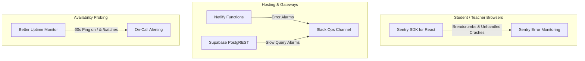

# Observability, Logging & Health Monitoring Architecture

**Platform:** Graviton Academy (Coaching Institute Management System)  
**Lead Auditor:** Principal Site Reliability Engineer (SRE)  
**Current Monitoring Maturity:** Level 1 (Basic Serverless Logs + In-App Activity Table)  

---

## 1. Existing Logging Infrastructure & Capabilities

| Layer | Log Provider | Retention | Captured Events | Gaps & Limitations |
|---|---|:---:|---|---|
| **Frontend Browser** | Local Console (`console.error`) | Ephemeral (Session) | Render errors, failed network calls | **CRITICAL GAP:** Zero telemetry exfiltration; client crashes invisible |
| **Serverless Proxy** | Netlify Function Logs | 7 Days | YouTube playlist requests, HTTP status codes, proxy errors | No automated error alerting |
| **Edge Push Function** | Supabase Edge Logs | 7 Days | VAPID push deliveries, dead endpoint prune logs | Basic stdout logging only |
| **API & Database** | Supabase Logs | 7 Days (Free) / 30 Days (Pro) | PostgREST HTTP queries, slow SQL queries, GoTrue auth events | Requires manual dashboard review |
| **Application Audit**| PostgreSQL `activity_logs` | Permanent | Faculty card additions, deletions, visibility changes | Unpartitioned table; requires periodic purge |

---

## 2. In-App Operational Audit Trail (`src/lib/activityLogger.js`)

The application logs operational actions to `public.activity_logs`:
```javascript
export async function logActivity({
  batch_id,
  user_name,
  user_role,
  action_type,  // 'create', 'update', 'delete', 'toggle_visibility'
  entity_type,  // 'study_card', 'homework', 'live_class', 'batch'
  entity_title,
  details,
}) {
  await supabase.from('activity_logs').insert([{ ... }])
}
```
- **Strengths:** Provides institute administrators with an auditable timeline of curriculum updates.
- **Defects:** Deleting a user in `AdminSettings.jsx` does not log an activity event, creating an audit blindspot for user terminations.

---

## 3. Recommended Production SRE Observability Stack



### 3.1 Immediate Implementation Steps
1. **Bootstrap Sentry SDK:**
   ```bash
   npm install @sentry/react
   ```
   Initialize in `src/main.jsx` to catch unhandled component crashes and PostgREST rejection errors.
2. **Configure Synthetic Uptime Ping:** Set up a free Better Uptime probe checking `https://thoughtfulacademy.com` every 60 seconds with SSL certificate expiration tracking.
