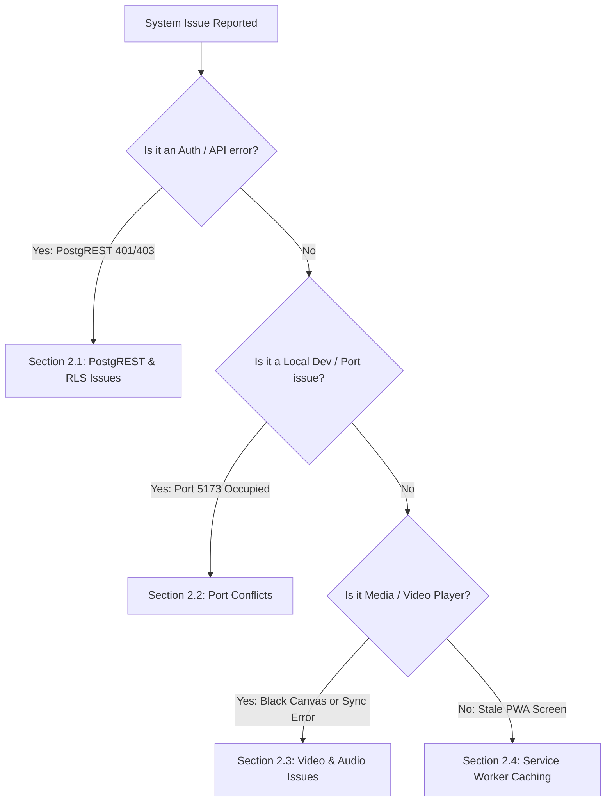

# Operational Troubleshooting & Diagnostics Guide

**Platform:** Graviton Academy (Coaching Institute Management System)  
**Target Audience:** DevOps Engineers, Support Staff & Developers  

---

## 1. Quick Diagnostics Decision Tree



---

## 2. Common Issues & Resolution Procedures

### 2.1 Issue 01: PostgREST `42501: new row violates row-level security policy`
- **Symptom:** Student or instructor action fails with a "Permission Denied" toast.
- **Root Cause:** The active JWT identity lacks permissions defined in PostgreSQL RLS policies for that specific table.
- **Diagnostic Steps:**
  1. Open Chrome DevTools -> **Network Tab** -> Find failing PostgREST request (`POST` or `PATCH`).
  2. Inspect Request Headers -> `Authorization: Bearer <token>`. Decode JWT at `jwt.io` to inspect `sub` (User UUID).
  3. Query Supabase database to check user status:
     ```sql
     SELECT id, role, is_active FROM public.profiles WHERE id = '<user-uuid>';
     ```
  4. If user is a teacher attempting to add cards or start live classes, verify flags in `public.teacher_profiles`:
     ```sql
     SELECT can_manage_study_cards, can_drop_live_class FROM public.teacher_profiles WHERE id = '<user-uuid>';
     ```

### 2.2 Issue 02: "Port 5173 is already in use" on `npm run dev`
- **Symptom:** Vite attempts to start on port 5174 instead of 5173.
- **Cause:** Another terminal or background task is running the Vite dev server.
- **Resolution:**
  Inspect what process is bound to port 5173:
  ```bash
  lsof -i :5173
  ```
  If it is an obsolete orphaned process, terminate it cleanly:
  ```bash
  kill -9 <PID>
  ```

### 2.3 Issue 03: Live Class 880Hz Audio Chime Does Not Sound
- **Symptom:** A live class starts and the banner displays, but no audible chime is heard.
- **Root Cause:** Modern browsers (Chrome, Safari) enforce **Autoplay Policies** that suspend the `AudioContext` until the user performs at least one physical click or tap gesture on the document.
- **Resolution:** The code handles this gracefully by muting audio if the context cannot resume, while ensuring the visual banner (`LiveClassBanner.jsx`) remains prominently visible.

### 2.4 Issue 04: PWA Serves Stale Code After Deployment
- **Symptom:** A new feature was deployed to Netlify, but mobile PWA clients still display the previous version.
- **Cause:** Workbox Service Worker serves precached assets from CacheStorage.
- **Resolution:**
  - For End Users: Close all tabs of the PWA and reopen; `vite-plugin-pwa` auto-updates and prompts for reload on next launch.
  - For Developers: Open DevTools -> **Application** -> **Service Workers** -> Click **"Update"** or **"Unregister"**, then hold `Shift` and click Reload.
