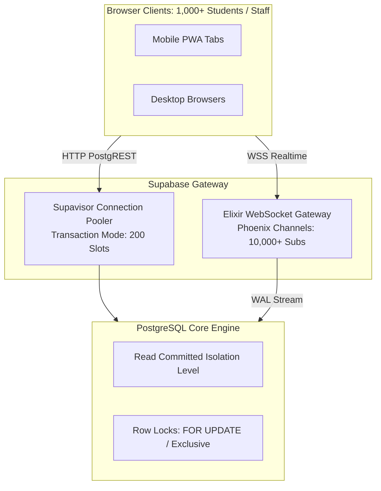

# Concurrency Model, Transaction Isolation & Contention Audit

**Platform:** Thoughtful's Academy (Coaching Institute Management System)  
**Database Engine:** PostgreSQL 15.6 with Supavisor Connection Pooler  
**Realtime Engine:** Phoenix Channels (Elixir / BEAM)  

---

## 1. Concurrency Architecture & Resource Model



---

## 2. PostgreSQL Transaction Isolation Level & Behavior

The database operates under standard **Read Committed** transaction isolation:
- Every query within a transaction sees only data committed before the query began.
- Does not prevent non-repeatable reads or phantom reads across concurrent transactions unless explicit locks are requested.

### 2.1 Concurrency Anomaly: Roll Number Sequence Race (`DATA-002`)
- In `supabase/migrations/014_handle_new_user.sql`:
  ```sql
  SELECT COUNT(*) + 1 INTO v_seq
  FROM public.student_profiles WHERE batch_id = v_batch_id;
  ```
- **Concurrency Defect:** If Transaction A and Transaction B commit signups concurrently, both execute `SELECT COUNT(*)` simultaneously. Both see count `14` and calculate `v_seq = 15`. One transaction commits successfully; the other aborts with a unique constraint violation when attempting to insert identical roll numbers.
- **Remediation:** Replace with explicit database sequences or wrap roll number assignment in `pg_advisory_xact_lock(hashtext(v_batch_id::text))`.

### 2.2 Attendance Idempotency Guard
- In `public.attendance`, duplicate check-in submissions are prevented via unique constraint `(student_id, date)`. Concurrent duplicate submissions automatically abort with code `23505 (unique_violation)` without corrupting daily records.

---

## 3. Realtime WebSocket Scaling via BEAM / Elixir

- Supabase Realtime operates on the **Erlang VM (BEAM)**, which utilizes lightweight Erlang processes consuming only ~2.5 kB memory per active WebSocket connection.
- 1,000 concurrent students listening to `live_classes` and `notifications` consume less than **15 MB RAM** on the Realtime gateway, ensuring absolute stability during institute-wide live broadcasts.
