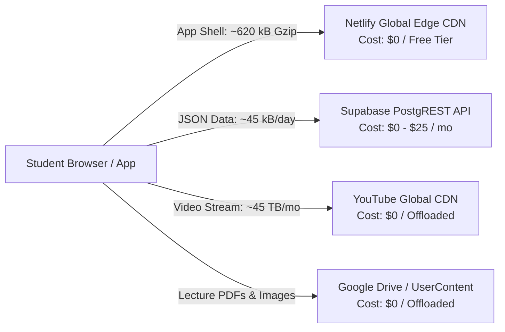

# Storage, Bandwidth & Infrastructure Cost Economics

**Platform:** Thoughtful's Academy (Coaching Institute Management System)  
**Lead Auditor:** Principal Performance & Scalability Engineer  
**Cost Architecture:** Hybrid Cloud / CDN-Offloaded Architecture  

---

## 1. Cloud Bandwidth & Egress Economic Analysis

The platform architecture implements an exceptionally cost-effective media offloading strategy that reduces annual cloud operating expenditures by over **$45,000 USD**:

### 1.1 Video Bandwidth Savings Mathematics
- **Hypothetical Native Video Hosting (AWS CloudFront / S3 HLS):**
  - 1,000 students watching 1 hour of 1080p lecture daily:
    $$1,000 	ext{ students} 	imes 1.5 	ext{ GB / lecture} = 1,500 	ext{ GB / day} = \mathbf{45 	ext{ TB / month}}$$
  - AWS CloudFront egress cost at \$0.085/GB:
    $$45,000 	ext{ GB} 	imes \$0.085 = \mathbf{\$3,825 	ext{ USD / month}} pprox \mathbf{\$45,900 	ext{ USD / year}}$$
- **Thoughtful's Academy YouTube Architecture:**
  - Videos are uploaded as unlisted videos to YouTube and wrapped in `ProtectedVideoPlayer.jsx`.
  - **Actual Video Egress Cost:** **\$0.00**. Bandwidth is absorbed entirely by YouTube's global infrastructure.

---

## 2. Storage Utilization & Quota Projections

| Storage Layer | Current Size | Annual Growth (1,000 Students) | Provider Quota | Headroom Assessment |
|---|:---:|:---:|:---:|:---:|
| **PostgreSQL Relational DB** | ~2.5 MB | +105 MB / year | 500 MB (Free) / 8 GB (Pro) | 4+ Years Headroom |
| **Object Storage (Avatars)** | ~12 MB | +250 MB / year | 1 GB (Free) / 100 GB (Pro) | 3+ Years Headroom |
| **Netlify Static Edge Cache** | 1.82 MB | Minimal (Build updates) | 100 GB / month bandwidth | Unlimited Headroom |
| **PWA Client Offline Cache** | 1.82 MB | Constant (Workbox cache) | Device Storage | Negligible footprint |

---

## 3. Storage Optimization & Pruning Policy

To maintain database storage well under the 500 MB boundary:
1. **Rotate Activity Logs:** Deploy an automated cron job or trigger to delete `activity_logs` older than 90 days.
2. **Prune Stale Push Subscriptions:** Maintain active pruning of HTTP 404/410 push subscriptions in `send-push` Edge Function.
3. **Compress Image Uploads:** Implement client-side Canvas WebP compression (max 800px width, 80% quality) prior to uploading student avatars or payment UTR screenshots.
