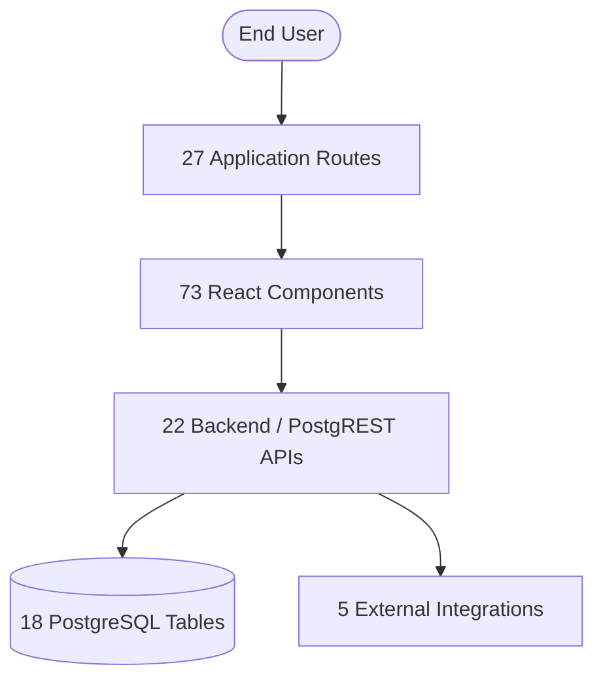

# Master Technical Inventory & Cross-Reference Index

**Platform:** Thoughtful's Academy (Coaching Institute Management System)  
**Total Source Files:** 73 UI Components/Pages (25,284 LOC) + 24 SQL Migrations + 2 Serverless Functions  
**Total Documentation Modules:** 12 Subsystems across `documentation/`  

---

## 1. Executive Platform Inventory Statistics

| Subsystem / Dimension | Cataloged Count | Primary Location in Codebase | Reference Documentation |
|---|:---:|---|---|
| **Frontend Routes** | **27 Routes** | `src/App.jsx` | `REGISTRY/ROUTE_REGISTRY.md` |
| **React UI Components** | **73 Components** | `src/components/`, `src/pages/` | `REGISTRY/COMPONENT_REGISTRY.md` |
| **Backend & Edge APIs** | **22 Interfaces** | PostgREST + Netlify + Deno Edge | `REGISTRY/API_REGISTRY.md` |
| **Database Tables** | **18 Tables** | `supabase/migrations/` | `REGISTRY/DATABASE_REGISTRY.md` |
| **Third-Party Integrations**| **5 Gateways** | YouTube, Drive, Web Push, FCM, Netlify | `REGISTRY/INTEGRATION_REGISTRY.md` |
| **Environment Variables** | **9 Variables** | `.env`, Netlify, Supabase Edge | `REGISTRY/ENVIRONMENT_VARIABLE_REGISTRY.md`|
| **Cataloged Platform Features**| **22 Features** | `FEAT-001` through `FEAT-022` | `FEATURES/FEATURE_CATALOG.md` |
| **Identified Audit Findings** | **30 Findings** | Security, Bugs, Perf, UX, Data | `FINDINGS/MASTER_FINDINGS_REGISTER.md` |

---

## 2. Cross-Subsystem Traceability Matrix

