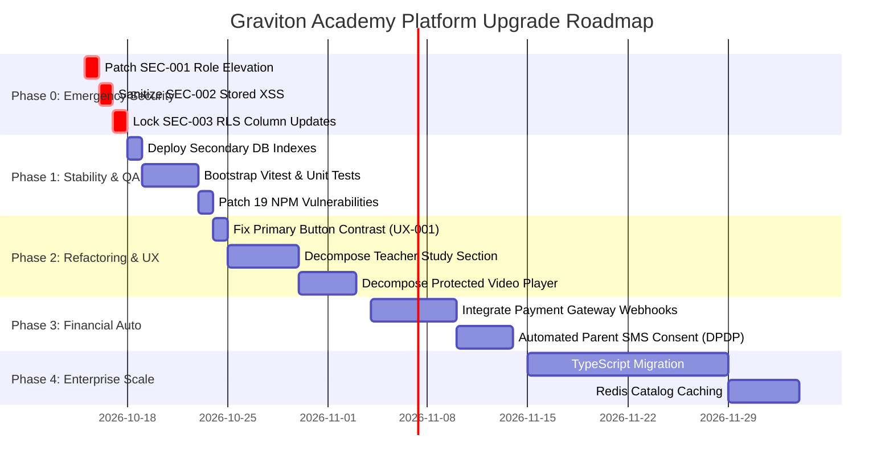

# Prioritized Platform Upgrade Roadmap

**Platform:** Graviton Academy (Coaching Institute Management System)  
**Planning Horizon:** Immediate Hotfix (P0) to Long-Term Vision (P4)  
**Lead Architect:** Principal Software Architect & Product Strategist  

---

## 1. Master Phased Upgrade Timeline

---

## 2. Granular Milestone Deliverables

### Phase 0: Immediate Emergency Security Hotfix (Days 1 - 3)
- **Goal:** Neutralize all exploitable attack vectors prior to production traffic.
- **Deliverables:**
  1. Patch `014_handle_new_user.sql` to eliminate client-controlled role assignment (`SEC-001`).
  2. Add `DOMPurify.sanitize` in `BatchDetails.jsx` line 532 (`SEC-002`).
  3. Deploy `BEFORE UPDATE` column protection triggers on `profiles` and `teacher_profiles` (`SEC-003`).
  4. Wrap `/watch/:cardId` inside `<RoleRoute>` guard in `App.jsx` (`BUG-001` / `SEC-006`).

### Phase 1: Core Reliability, Indexing & Test Harness (Days 4 - 8)
- **Goal:** Eliminate database sequential scans and establish automated regression safety.
- **Deliverables:**
  1. Apply `025_add_performance_indexes.sql` to index foreign keys (`batch_id`, `student_id`).
  2. Install Vitest, `@testing-library/react`, and establish baseline unit tests for formatters and utilities.
  3. Add `package.json` overrides to resolve all 19 NPM supply chain vulnerabilities (`SEC-007`).

### Phase 2: Component Refactoring & Accessibility Compliance (Days 9 - 18)
- **Goal:** Decompose monolithic code hubs and achieve WCAG 2.2 AA accessibility compliance.
- **Deliverables:**
  1. Update `.btn-primary` in `src/index.css` to dark navy text on saffron (`UX-001`).
  2. Decompose `TeacherStudySection.jsx` into 4 dedicated modal dialogs and isolated card lists.
  3. Separate doubt chat panel from video watermark canvas in `ProtectedVideoPlayer.jsx`.
  4. Add missing `aria-label` tags to icon buttons across navigation shells.

### Phase 3: Automated Financial Infrastructure & DPDP Compliance (Days 19 - 28)
- **Goal:** Automate fee collection and satisfy Indian minor data protection statutory requirements.
- **Deliverables:**
  1. Replace manual UTR entry with Razorpay/Cashfree payment gateway webhooks.
  2. Implement parent SMS OTP consent verification during student onboarding (DPDP Act Sec 9).
  3. Deploy Edge Function for clean user deletion cascading to `auth.users` (`DATA-001`).

### Phase 4: Enterprise Scalability & Type Safety (Days 29 - 45)
- **Goal:** Full enterprise readiness supporting 25,000+ enrolled students.
- **Deliverables:**
  1. Migrate codebase from JavaScript (`.jsx`) to TypeScript (`.tsx`) using generated Supabase types.
  2. Deploy Upstash Redis caching for public batch curriculum queries.
  3. Implement automated GitHub Actions CI/CD pipeline with staging preview deployments.
