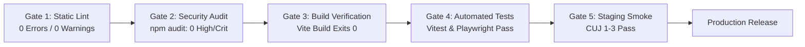

# Release Verification Gates & Quality Sign-Off Checklist

**Platform:** Graviton Academy (Coaching Institute Management System)  
**Lead QA Architect:** Principal QA Automation Engineer & Release Manager  

---

## 1. Automated Release Verification Gates

Before any pull request is merged into `main` or deployed to production, it must successfully pass 5 sequential quality gates:

---

## 2. Release Candidate Pre-Flight Checklist

### 2.1 Code & Build Verification
- [ ] `npm run lint` passes with 0 errors and 0 warnings.
- [ ] `npm run build` succeeds in under 15 seconds without Rollup chunk size warnings.
- [ ] `npm audit` confirms zero Critical or High vulnerabilities.
- [ ] No `console.log` statements with sensitive customer PII or tokens remain in PR diff.

### 2.2 Security & Data Protection Sign-off
- [ ] Verify that `VITE_ADMIN_CODE` is absent from client source code.
- [ ] Verify that all user-supplied rich text is sanitized via `DOMPurify`.
- [ ] Verify that any new database tables enforce Row Level Security (`ENABLE ROW LEVEL SECURITY`).
- [ ] Verify that `FOR UPDATE` RLS policies contain column restriction triggers or `WITH CHECK` clauses.

### 2.3 Post-Deployment Staging Sanity Run
- [ ] Register a new student account: verify roll number generated properly (`YYYY-PREFIX-001`).
- [ ] Log in as Teacher: create test study card; verify video plays with dynamic watermark canvas.
- [ ] Submit test fee with 12-digit UTR: verify admin fee manager receives pending record and can approve.
- [ ] Trigger a test live class: assert that synthetic 880Hz audio chime sounds in student session.

---

## 3. Emergency Rollback Playbook

If a critical defect escapes into production:
1. **Frontend Instant Rollback:** Open Netlify Dashboard -> **Deploys** -> Select previous stable deployment -> Click **"Publish deploy"**. Netlify rolls back all global edge CDN nodes in under 5 seconds.
2. **Database Schema Rollback:** If a migration corrupted tables, execute the corresponding `down` migration script or restore from the pre-deployment snapshot via `pg_restore`.
