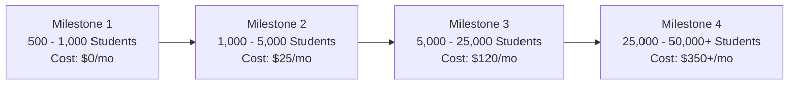

# Scalability Roadmap: Scaling from 500 to 50,000+ Students

**Platform:** Graviton Academy (Coaching Institute Management System)  
**Lead Scalability Architect:** Principal Systems Architect  
**Objective:** Define capacity scaling thresholds, infrastructure upgrades, and cost projections.  

---

## 1. Capacity Scaling Horizons & Milestones

---

## 2. Granular Milestone Engineering Specifications

### Milestone 1: Free Tier Optimization (500 - 1,000 Students | \$0 / mo)
- **Bottlenecks Mitigated:** Sequential scans on `study_cards` and `student_profiles`.
- **Infrastructure Deliverables:**
  - Deploy composite B-tree indexes (`025_add_performance_indexes.sql`).
  - Implement client-side TanStack Query to deduplicate batch queries across tabs.
  - Implement advisory locks on roll number sequence generation.

### Milestone 2: Pro Compute & Connection Scaling (1,000 - 5,000 Students | \$25 / mo)
- **Bottlenecks Mitigated:** Connection starvation during 8:30 AM attendance spikes.
- **Infrastructure Deliverables:**
  - Upgrade Supabase to Pro Tier (\$25/month) to expand Supavisor pooler to 500 transaction slots.
  - Enable continuous automated WAL-G physical database backups with 7-day PITR.
  - Virtualize long curriculum card lists in `TeacherStudySection.jsx` using `@tanstack/react-virtual`.

### Milestone 3: Distributed Caching & Payment Automation (5,000 - 25,000 Students | \$120 / mo)
- **Bottlenecks Mitigated:** Manual administrative fee reconciliation and public catalog database hits.
- **Infrastructure Deliverables:**
  - Integrate Razorpay / Cashfree webhook listeners in Supabase Edge Functions for zero-latency fee verification.
  - Deploy Upstash Redis edge cache for public course landing pages (`/`, `/batch-details`), offloading 80% of database read queries.
  - Partition `activity_logs` table by month to maintain fast sequential scans on active logs.

### Milestone 4: Enterprise Read Replicas & High Availability (25,000+ Students | \$350+ / mo)
- **Bottlenecks Mitigated:** Master database CPU saturation and geographical network latency.
- **Infrastructure Deliverables:**
  - Deploy PostgreSQL read replicas in AWS Mumbai to handle student query traffic.
  - Separate reporting and analytics queries to a replica instance to preserve primary compute for write transactions.
