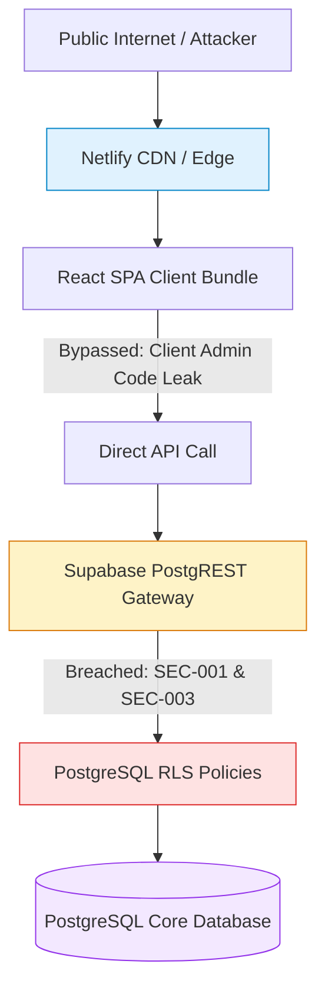

# Security Architecture & Posture Overview

**Platform:** Graviton Academy (Coaching Institute Management System)  
**Security Posture:** High Risk (Critical Privilege Escalation & Stored XSS Vulnerabilities Identified)  
**Lead Auditor:** Principal Cybersecurity Auditor & Application Security Architect  
**Evaluation Standard:** OWASP Top 10 (2021/2025), STRIDE Threat Modeling, and CIS Benchmarks  

---

## 1. Executive Security Summary

An exhaustive forensic security audit was conducted across the source code, database policies, runtime functions, and dependency tree of Graviton Academy.

While the platform employs modern security foundations—such as **100% Row Level Security (RLS)** enablement on all public tables, parameterized PostgREST SQL generation, and cryptographic JWT verification—the audit identified **two critical (P0) security vulnerabilities** that completely compromise platform integrity if exploited:
1. **`SEC-001` (P0 Critical):** Client-Controlled Admin Role Assignment during Registration (`014_handle_new_user.sql`).
2. **`SEC-002` (P0 Critical):** Stored Cross-Site Scripting (XSS) in Public Curriculum View (`BatchDetails.jsx`).
3. **`SEC-003` (P0 Critical):** Unconstrained Column Updates via PostgREST RLS (`002_rls_policies.sql`).
4. **`SEC-004` (P1 High):** Public Client Bundle Exposure of Administrative Secret (`VITE_ADMIN_CODE`).

Immediate, prioritized remediation of these vulnerabilities is required prior to production deployment with live student PII or fee payments.

---

## 2. Threat Landscape & Attack Surface

The platform exposes four primary attack vectors:
1. **Public Supabase Auth Gateway (`/auth/v1`):** Anyone on the internet can call `signUp()` with arbitrary metadata payloads.
2. **PostgREST Direct Data Gateway (`/rest/v1`):** Authenticated users interact directly with PostgreSQL tables. RLS policies are the sole barrier preventing unauthorized read/write access.
3. **Client-Side SPA DOM Rendering:** User-generated course details, student doubt messages, and announcements are rendered in the React virtual DOM.
4. **Third-Party Integrations:** Public YouTube playlist feeds, Google Drive asset proxies, and browser Web Push VAPID relays.

---

## 3. Defense-in-Depth Assessment

- **Perimeter Security:** Protected via Cloudflare / Netlify SSL termination.
- **Identity & Access Management (IAM):** Handled via Supabase GoTrue JWTs (HS256 signature).
- **Authorization Engine:** RLS functions `is_admin()`, `get_my_role()`, `teacher_can()`.
- **Vulnerability Status:** RLS policies lack column-level UPDATE guards, undermining the database security perimeter.
