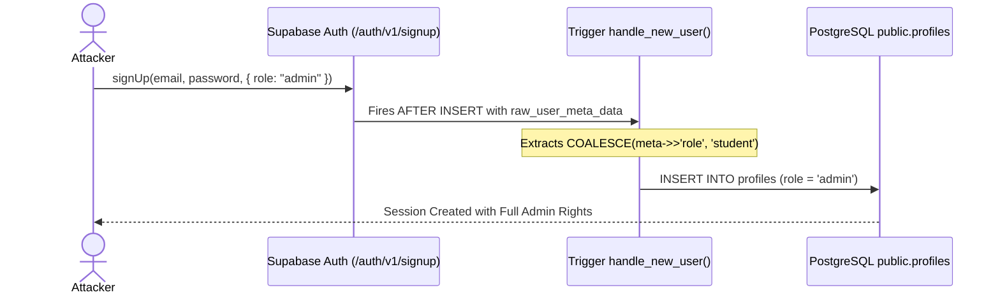
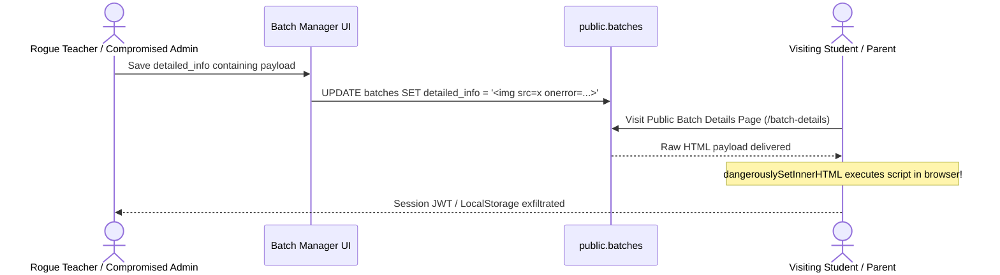

# Threat Model & STRIDE Forensic Risk Assessment

**Platform:** Thoughtful's Academy (Coaching Institute Management System)  
**Methodology:** Microsoft STRIDE Threat Modeling Framework  
**Scope:** Client Application, Network Boundaries, PostgREST Gateway, Serverless Functions, and PostgreSQL Storage  

---

## 1. STRIDE Threat Categorization Matrix

| STRIDE Category | Threat Description | Attack Vector / Component | Existing Mitigation | Residual Risk | Defect ID |
|---|---|---|---|:---:|:---:|
| **Spoofing Identity** | Attacker registers new account as Administrator | `POST /auth/v1/signup` with `role: "admin"` in user metadata | None in trigger | **CRITICAL** | `SEC-001` |
| **Tampering with Data** | Student modifies own role to `admin` or teacher modifies own `salary_amount` | Direct PostgREST `PATCH /rest/v1/profiles` or `teacher_profiles` | RLS checks `auth.uid() = id`, but lacks column checks | **CRITICAL** | `SEC-003` |
| **Tampering with Data** | Attacker injects malicious script into batch curriculum description | Stored HTML in `batches.detailed_info` | None; rendered via `dangerouslySetInnerHTML` | **CRITICAL** | `SEC-002` |
| **Repudiation** | Instructor denies deleting study cards or changing grades | Deletion / update actions on curriculum and submissions | `activity_logs` logs study card actions; homework updates unlogged | **MEDIUM** | `SEC-005` |
| **Information Disclosure** | Extracted Admin bypass secret from public frontend bundle | Static inspection of compiled Rollup chunk `Register-*.js` | None; bundled as `import.meta.env.VITE_ADMIN_CODE` | **HIGH** | `SEC-004` |
| **Information Disclosure** | Unauthenticated user streams private study card lectures | Direct URL navigation to `/watch/:cardId` | Client route lacks AuthGuard check | **HIGH** | `BUG-001` |
| **Denial of Service** | Threat actor floods YouTube playlist proxy with requests | HTTP GET loop on `/.netlify/functions/youtube-playlist` | None; endpoint lacks IP rate limiting | **MEDIUM** | `BED-007` |
| **Elevation of Privilege** | Student acquires full administrative superuser capabilities | Combined exploitation of `SEC-001` or `SEC-003` | None; granting admin role provides full DB write access | **CRITICAL** | `SEC-001` |

---

## 2. Threat Vector Deep Dives

### 2.1 Elevation of Privilege (EoP) via Registration Payload Injection

### 2.2 Stored Cross-Site Scripting (XSS) via Batch Description

---

## 3. Threat Mitigation Summary & Action Items

1. **Eliminate Client Role Injection:** Enforce immutable `role := 'student'` in `handle_new_user()`.
2. **Implement Column-Level RLS Locks:** Create `BEFORE UPDATE` trigger on `profiles` rejecting modifications to `role` unless `is_admin()`.
3. **DOM Sanitization:** Sanitize all rich text using `DOMPurify` before injecting into the DOM.
4. **Remove Bundled Secrets:** Eliminate `VITE_ADMIN_CODE` from frontend bundles.
