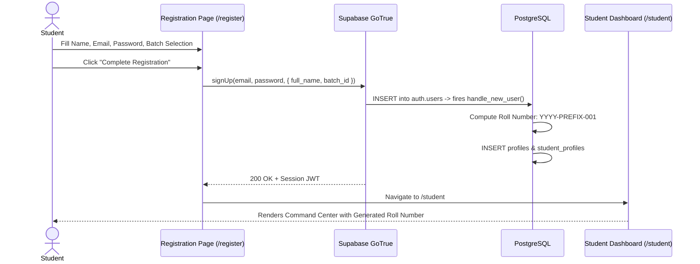
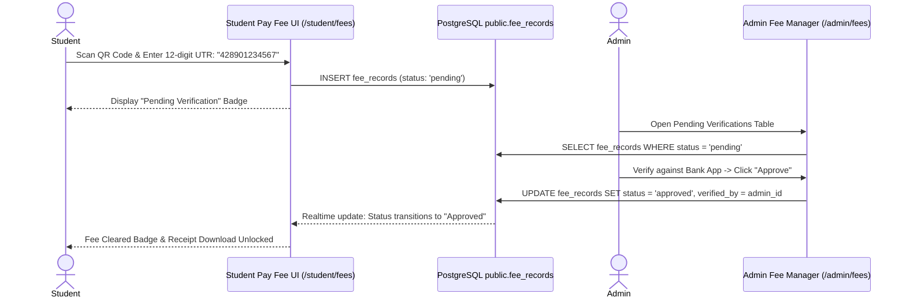

# Critical User Journey (CUJ) End-to-End Test Specifications

**Platform:** Graviton Academy (Coaching Institute Management System)  
**Standard:** Automated End-to-End Test Specifications (Playwright-Ready)  
**Target Roles:** Student, Faculty (Teacher), Administrator  

---

## 1. CUJ-01: Prospective Student Onboarding & Roll Number Allocation

### 1.1 Acceptance Criteria & Verification Gates
1. Student profile record is created in `public.profiles` with `role = 'student'`.
2. Student profile record in `public.student_profiles` has non-null `roll_number` matching pattern `^20\d{2}-[A-Z]{1,4}-\d{3}$`.
3. Student is automatically enrolled in selected batch with `is_active = true`.
4. Browser redirects immediately to `/student` without manual email confirmation delay.

---

## 2. CUJ-02: Offline UPI Payment Reconciliation Lifecycle

### 2.1 Acceptance Criteria & Verification Gates
1. UTR inputs reject any string not exactly 12 numeric digits (`/^\d{12}$/`).
2. Student cannot submit duplicate pending records for the identical batch and month.
3. Admin approval records the verifying administrator's UUID in `verified_by`.
4. Student UI reflects approval state without requiring a hard browser refresh.

---

## 3. CUJ-03: Curriculum Authoring, Piracy Watermarking & Doubts

### 3.1 Scenario Steps
1. **Teacher Action:** Teacher logs in and opens `/teacher/study`. Selects batch "JEE Mains 2026", creates chapter "Thermodynamics", and adds a study card with YouTube video URL.
2. **Student Action:** Enrolled student navigates to `/student/study`, selects chapter, and launches the study card video player.
3. **Watermark Verification:** The HTML5 `<canvas>` renders dynamic watermarking text displaying the student's full name, roll number, and bouncing timestamp coordinates.
4. **Doubt Submission:** At video timestamp 04:15, student opens the doubt drawer and types "Why does internal energy only depend on temperature in ideal gases?".
5. **Teacher Resolution:** Teacher opens `/teacher/messages` or card comments, sees timestamped doubt linked to 04:15, and posts explanatory response.
