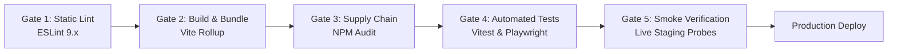

# Platform Regression Test Plan & Release Verification Gates

**Platform:** Graviton Academy (Coaching Institute Management System)  
**Target Release Gate:** Production Deployment Verification  
**Audit Reference:** QA Automation & Release Engineering  

---

## 1. Release Verification Pipeline & Gates

Prior to merging any pull request or deploying code to production (Netlify / Supabase), the following quality gates must execute:

---

## 2. Pre-Deployment Smoke Test Checklist (30-Minute Run)

| Step | Subsystem | Action | Expected Result | Pass / Fail Criteria |
|:---:|---|---|---|:---:|
| 1 | Infrastructure | Fetch landing page `/` | HTTP 200, HTML contains `#root`, loads without console errors | Mandatory |
| 2 | Auth | Login as Test Student | Session established; redirect to `/student`; role badge is green | Mandatory |
| 3 | Auth | Login as Test Teacher | Session established; redirect to `/teacher`; role badge is blue | Mandatory |
| 4 | Auth | Login as Test Admin | Session established; redirect to `/admin`; role badge is purple | Mandatory |
| 5 | Security | Attempt student access to `/admin` | Handled by `RoleRoute`; redirects to `/student` or displays 403 | Mandatory |
| 6 | Curriculum | Open Study Card Video Player | Video iframe mounts; dynamic canvas watermark renders | Mandatory |
| 7 | Payment | Submit 12-digit UTR on `/student/fees` | Record saved in `pending` state with success toast | Mandatory |
| 8 | Admin | Approve pending fee in `/admin/fees` | Record status transitions to `approved`; student UI updates | Mandatory |
| 9 | Realtime | Start live class in `/teacher/live` | Student tab receives broadcast; audio chime triggers | Mandatory |
| 10 | Proxy | Query `/api/youtube-playlist?listId=PL...` | Returns HTTP 200 with XML payload and valid CORS header | Mandatory |

---

## 3. High-Risk Regression Scenarios

### 3.1 Migration Regression Testing
Whenever modifying `supabase/migrations/`:
1. Verify migrations apply cleanly on a blank database instance (`supabase db reset`).
2. Verify migrations apply cleanly on an existing staging database containing legacy test data.
3. Test all RLS policies for: unauthenticated access, student access, teacher access, admin access.

### 3.2 Frontend Build Regression Testing
1. Execute `npm run build` to verify Rollup chunk size does not exceed warning threshold (500 kB per chunk).
2. Validate that `index.html` loads all bundled assets without circular reference deadlocks.
3. Verify PWA Workbox precaching registers service worker cleanly.
