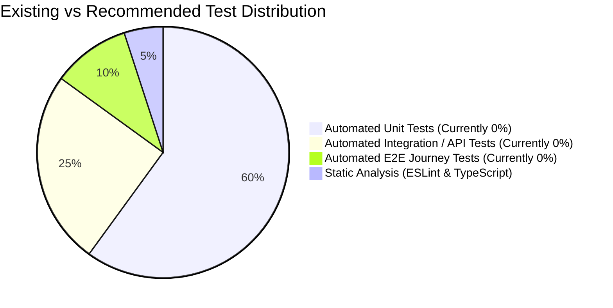

# Platform Testing Strategy & Quality Assurance Overview

**Platform:** Thoughtful's Academy (Coaching Institute Management System)  
**Lead QA Architect:** Principal QA Automation Engineer & Reliability Specialist  
**Automated Test Coverage:** 0.00% (No Unit, Integration, or E2E Test Files in Codebase)  
**Static Verification Status:** Clean (ESLint 0 errors, Vite Rollup build 100% successful)  

---

## 1. Executive Quality Assurance Summary

The platform codebase exhibits a significant gap in automated test automation:
- **Zero Unit Tests:** No unit tests exist for utility functions (`formatters.js`, `youtube.js`, `studyHelpers.js`), hooks (`useNavBadges.js`, `useRealtime.js`), or React components.
- **Zero Integration / E2E Tests:** No Playwright, Cypress, or Vitest suites exist to validate user registration flows, fee submission reconciliation, or live attendance logging.
- **Existing Quality Gates:** Current verification relies exclusively on:
  1. Build-time TypeScript/Babel compilation and Rollup bundling (`npm run build`).
  2. Static lint analysis (`npm run lint` via ESLint 9.13.0).
  3. Ad-hoc manual verification in local development environments.

---

## 2. Testing Pyramid Gap Analysis

- **Current State:** The inverted test pyramid (100% manual testing) creates severe regression risk during upgrades, refactoring, and database schema migrations.
- **Target Target:** Establish a modern testing harness using **Vitest** for component/unit tests and **Playwright** for critical end-to-end user journeys.

---

## 3. High-Risk Functional Areas Lacking Coverage

1. **Automated Roll Number Generation:** No test verifies roll number sequence formatting or concurrent enrollment uniqueness.
2. **Fee Reconciliation Workflow:** No automated test verifies that student UTR submission updates `pending` state and triggers administrative review queues.
3. **Role Elevation & RBAC:** No automated regression tests prevent unauthorized access to `/admin/*` or `/teacher/*` routes.
4. **YouTube Playlist Parser Proxy:** No automated test validates edge cases in playlist XML syndication or video ID fallback scraping.
